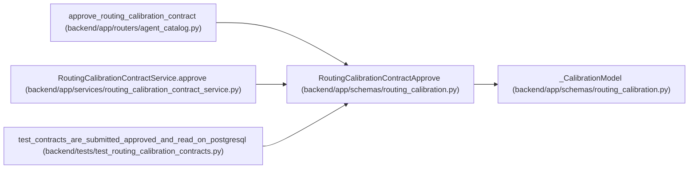

# RoutingCalibrationContractApprove

**Location:** `backend/app/schemas/routing_calibration.py:176`
**Kind:** Pydantic model
**Bases:** `_CalibrationModel`
**Module:** [schemas_routing_calibration](../modules/schemas_routing_calibration.md)

## Description

Approve the current submitted terms, named by revision and digest.

``approved_as`` is the declared approver the caller approves as; it must
equal the terms' ``approver``. The authenticated principal is recorded
separately as ``approved_by``.

## Validators

| Method | Scope | Fields | Mode | Options |
|--------|-------|--------|------|---------|
| `strip_approved_as` | field | approved_as | after | — |

## Attributes

| Name | Type | Wire name | Required | Nullable | Default | Constraints | Examples | Description |
|------|------|-----------|----------|----------|---------|-------------|-------------|----------|
| `expected_revision` | `PositiveRevision` | `expected_revision` | Yes | No | — | — | — | — |
| `expected_terms_digest` | `RoutingDigest` | `expected_terms_digest` | Yes | No | — | — | — | — |
| `approved_as` | `str` | `approved_as` | Yes | No | — | min_length=1; max_length=unknown (MAX_CALIBRATION_LABEL) | — | — |

## Methods

| Method | Signature | Decorators | Description |
|--------|-----------|------------|-------------|
| `strip_approved_as` | `(value: str) -> str` | `@field_validator('approved_as')`, `@classmethod` | — |

## Relationships

<!-- Auto-generated relationship summary. Do not edit by hand. -->

### Summary

| Module | Methods | Attributes |
|---|---:|---|
| [schemas_routing_calibration](../modules/schemas_routing_calibration.md) | 1 | `approved_as`, `expected_revision`, `expected_terms_digest` |

### Structure

| Kind | Entity | Module |
|---|---|---|
| Base | `_CalibrationModel` | [schemas_routing_calibration](../modules/schemas_routing_calibration.md) |

### References

| Reference | Kind | Source | Call sites |
|---|---|---|---:|
| `approve_routing_calibration_contract` | type_reference | [agent_catalog](../modules/agent_catalog.md) | — |
| `RoutingCalibrationContractService.approve` | type_reference | [routing_calibration_contract_service](../modules/routing_calibration_contract_service.md) | — |
| `test_contracts_are_submitted_approved_and_read_on_postgresql` | call | [test_routing_calibration_contracts](../modules/test_routing_calibration_contracts.md) | 2 |
