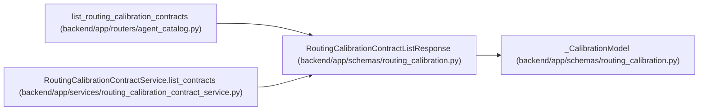

# RoutingCalibrationContractListResponse

**Location:** `backend/app/schemas/routing_calibration.py:273`
**Kind:** Pydantic model
**Bases:** `_CalibrationModel`
**Module:** [schemas_routing_calibration](../modules/schemas_routing_calibration.md)

## Description

The deployment's contracts, and whether routing may treat any as approved.

## Attributes

| Name | Type | Wire name | Required | Nullable | Default | Constraints | Examples | Description |
|------|------|-----------|----------|----------|---------|-------------|-------------|----------|
| `schema_version` | `Literal['routing-calibration-contract-v1']` | `schema_version` | No | No | `CALIBRATION_CONTRACT_SCHEMA_VERSION` | — | — | — |
| `approved_contract_exists` | `bool` | `approved_contract_exists` | Yes | No | — | — | — | — |
| `performance_history_use` | `Literal['advisory']` | `performance_history_use` | No | No | `'advisory'` | — | — | Routing does not consume performance history, whether or not a contract is approved. |
| `contracts` | `list[RoutingCalibrationContractResponse]` | `contracts` | Yes | No | — | — | — | — |

## Methods

*No declared methods.*

## Relationships

<!-- Auto-generated relationship summary. Do not edit by hand. -->

### Summary

| Module | Methods | Attributes |
|---|---:|---|
| [schemas_routing_calibration](../modules/schemas_routing_calibration.md) | 0 | `approved_contract_exists`, `contracts`, `performance_history_use`, `schema_version` |

### Structure

| Kind | Entity | Module |
|---|---|---|
| Base | `_CalibrationModel` | [schemas_routing_calibration](../modules/schemas_routing_calibration.md) |

### References

| Reference | Kind | Source | Call sites |
|---|---|---|---:|
| `list_routing_calibration_contracts` | type_reference | [agent_catalog](../modules/agent_catalog.md) | — |
| `RoutingCalibrationContractService.list_contracts` | call | [routing_calibration_contract_service](../modules/routing_calibration_contract_service.md) | 1 |
| `RoutingCalibrationContractService.list_contracts` | type_reference | [routing_calibration_contract_service](../modules/routing_calibration_contract_service.md) | — |
