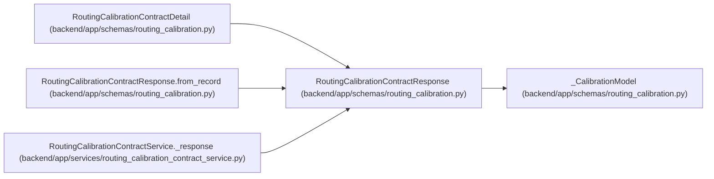

# RoutingCalibrationContractResponse

**Location:** `backend/app/schemas/routing_calibration.py:201`
**Kind:** Pydantic model
**Bases:** `_CalibrationModel`
**Module:** [schemas_routing_calibration](../modules/schemas_routing_calibration.md)

## Description

The current revision of one contract.

## Attributes

| Name | Type | Wire name | Required | Nullable | Default | Constraints | Examples | Description |
|------|------|-----------|----------|----------|---------|-------------|-------------|----------|
| `id` | `int` | `id` | Yes | No | — | — | — | — |
| `key` | `str` | `key` | Yes | No | — | — | — | — |
| `schema_version` | `Literal['routing-calibration-contract-v1']` | `schema_version` | Yes | No | — | — | — | — |
| `state` | `CalibrationContractState` | `state` | Yes | No | — | — | — | — |
| `revision` | `PositiveRevision` | `revision` | Yes | No | — | — | — | — |
| `terms` | `RoutingCalibrationContractTerms` | `terms` | Yes | No | — | — | — | — |
| `terms_digest` | `RoutingDigest` | `terms_digest` | Yes | No | — | — | — | — |
| `submitted_by` | `CalibrationContractActor` | `submitted_by` | Yes | No | — | — | — | — |
| `submitted_at` | `datetime` | `submitted_at` | Yes | No | — | — | — | — |
| `approved_by` | `CalibrationContractActor \| None` | `approved_by` | No | Yes | `None` | — | — | The authenticated principal that approved the current terms. |
| `approved_as` | `str \| None` | `approved_as` | No | Yes | `None` | — | — | The declared approver (the terms' approver) the approval was given as. |
| `approved_at` | `datetime \| None` | `approved_at` | No | Yes | `None` | — | — | — |
| `approval_reason` | `str \| None` | `approval_reason` | No | Yes | `None` | — | — | — |
| `created_at` | `datetime` | `created_at` | Yes | No | — | — | — | — |
| `updated_at` | `datetime` | `updated_at` | Yes | No | — | — | — | — |

## Methods

| Method | Signature | Decorators | Description |
|--------|-----------|------------|-------------|
| `from_record` | `(row: Any) -> 'RoutingCalibrationContractResponse'` | `@classmethod` | — |

## Relationships

<!-- Auto-generated relationship summary. Do not edit by hand. -->

### Summary

| Module | Methods | Attributes |
|---|---:|---|
| [schemas_routing_calibration](../modules/schemas_routing_calibration.md) | 1 | `approval_reason`, `approved_as`, `approved_at`, `approved_by`, `created_at`, `id`, `key`, `revision`, `schema_version`, `state`, `submitted_at`, `submitted_by` |

### Structure

| Kind | Entity | Module |
|---|---|---|
| Base | `_CalibrationModel` | [schemas_routing_calibration](../modules/schemas_routing_calibration.md) |
| Subclass | `RoutingCalibrationContractDetail` | [schemas_routing_calibration](../modules/schemas_routing_calibration.md) |

### References

| Reference | Kind | Source | Call sites |
|---|---|---|---:|
| `RoutingCalibrationContractResponse.from_record` | call | [schemas_routing_calibration](../modules/schemas_routing_calibration.md) | 1 |
| `RoutingCalibrationContractResponse.from_record` | type_reference | [schemas_routing_calibration](../modules/schemas_routing_calibration.md) | — |
| `RoutingCalibrationContractService._response` | type_reference | [routing_calibration_contract_service](../modules/routing_calibration_contract_service.md) | — |
