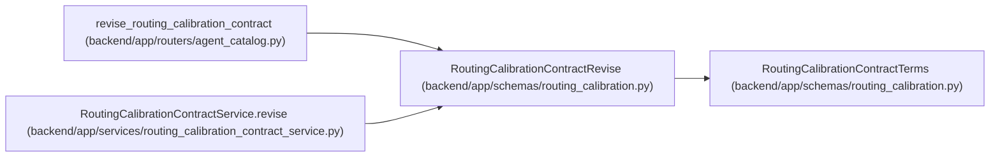

# RoutingCalibrationContractRevise

**Location:** `backend/app/schemas/routing_calibration.py:170`
**Kind:** Pydantic model
**Bases:** `RoutingCalibrationContractTerms`
**Module:** [schemas_routing_calibration](../modules/schemas_routing_calibration.md)

## Description

Submit complete new terms for an existing contract; any approval lapses.

## Attributes

| Name | Type | Wire name | Required | Nullable | Default | Constraints | Examples | Description |
|------|------|-----------|----------|----------|---------|-------------|-------------|----------|
| `expected_revision` | `PositiveRevision` | `expected_revision` | Yes | No | — | — | — | — |

## Methods

*No declared methods.*

## Relationships

<!-- Auto-generated relationship summary. Do not edit by hand. -->

### Summary

| Module | Methods | Attributes |
|---|---:|---|
| [schemas_routing_calibration](../modules/schemas_routing_calibration.md) | 0 | `expected_revision` |

### Structure

| Kind | Entity | Module |
|---|---|---|
| Base | `RoutingCalibrationContractTerms` | [schemas_routing_calibration](../modules/schemas_routing_calibration.md) |

### References

| Reference | Kind | Source | Call sites |
|---|---|---|---:|
| `revise_routing_calibration_contract` | type_reference | [agent_catalog](../modules/agent_catalog.md) | — |
| `RoutingCalibrationContractService.revise` | type_reference | [routing_calibration_contract_service](../modules/routing_calibration_contract_service.md) | — |
