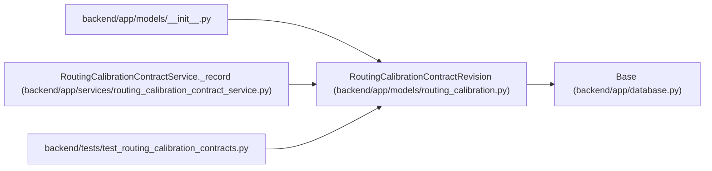

# RoutingCalibrationContractRevision

**Location:** `backend/app/models/routing_calibration.py:82`
**Kind:** Class
**Bases:** `Base`
**Module:** [models_routing_calibration](../modules/models_routing_calibration.md)

## Description

The terms and state a contract had after one submit or approve command, and why.

## Attributes

| Name | Type | Default | Description |
|------|------|---------|-------------|
| `id` | `Mapped[int]` | `mapped_column(Integer, primary_key=True, autoincrement=True)` | — |
| `contract_id` | `Mapped[int]` | `mapped_column(Integer, ForeignKey('routing_calibration_contracts.id', ondelete='RESTRICT'), nullable=False)` | — |
| `revision` | `Mapped[int]` | `mapped_column(Integer, nullable=False)` | — |
| `action` | `Mapped[str]` | `mapped_column(String(20), nullable=False)` | — |
| `state` | `Mapped[str]` | `mapped_column(String(20), nullable=False)` | — |
| `terms` | `Mapped[dict[str, Any]]` | `mapped_column(JSON, nullable=False)` | — |
| `terms_digest` | `Mapped[str]` | `mapped_column(String(64), nullable=False)` | — |
| `reason` | `Mapped[str]` | `mapped_column(Text, nullable=False)` | — |
| `approved_as` | `Mapped[Optional[str]]` | `mapped_column(String(255), nullable=True)` | — |
| `actor_type` | `Mapped[str]` | `mapped_column(String(50), nullable=False)` | — |
| `actor_id` | `Mapped[Optional[int]]` | `mapped_column(Integer, ForeignKey('agent_actors.id'), nullable=True)` | — |
| `correlation_id` | `Mapped[Optional[str]]` | `mapped_column(String(255))` | — |
| `created_at` | `Mapped[datetime]` | `mapped_column(UTCDateTime(), default=utc_now, nullable=False)` | — |
| `contract` | `Mapped[RoutingCalibrationContract]` | `relationship(RoutingCalibrationContract, back_populates='revisions')` | — |

## Methods

*No declared methods.*

## Relationships

<!-- Auto-generated relationship summary. Do not edit by hand. -->

### Summary

| Module | Methods | Attributes |
|---|---:|---|
| [models_routing_calibration](../modules/models_routing_calibration.md) | 0 | `action`, `actor_id`, `actor_type`, `approved_as`, `contract`, `contract_id`, `correlation_id`, `created_at`, `id`, `reason`, `revision`, `state` |

### Structure

| Kind | Entity | Module |
|---|---|---|
| Base | `Base` | [app_database](../modules/app_database.md) |

### References

| Reference | Kind | Source | Call sites |
|---|---|---|---:|
| `__init__` | import | [models___init__](../modules/models___init__.md) | — |
| `RoutingCalibrationContractService._record` | call | [routing_calibration_contract_service](../modules/routing_calibration_contract_service.md) | 1 |
| `test_routing_calibration_contracts` | import | [test_routing_calibration_contracts](../modules/test_routing_calibration_contracts.md) | — |
