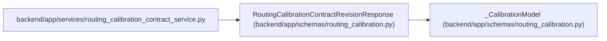

# RoutingCalibrationContractRevisionResponse

**Location:** `backend/app/schemas/routing_calibration.py:251`
**Kind:** Pydantic model
**Bases:** `_CalibrationModel`
**Module:** [schemas_routing_calibration](../modules/schemas_routing_calibration.md)

## Description

One append-only command on a contract, with its terms and reason.

## Attributes

| Name | Type | Wire name | Required | Nullable | Default | Constraints | Examples | Description |
|------|------|-----------|----------|----------|---------|-------------|-------------|----------|
| `revision` | `PositiveRevision` | `revision` | Yes | No | — | — | — | — |
| `action` | `CalibrationContractAction` | `action` | Yes | No | — | — | — | — |
| `state` | `CalibrationContractState` | `state` | Yes | No | — | — | — | — |
| `terms` | `RoutingCalibrationContractTerms` | `terms` | Yes | No | — | — | — | — |
| `terms_digest` | `RoutingDigest` | `terms_digest` | Yes | No | — | — | — | — |
| `reason` | `str` | `reason` | Yes | No | — | — | — | — |
| `approved_as` | `str \| None` | `approved_as` | No | Yes | `None` | — | — | — |
| `actor_type` | `str` | `actor_type` | Yes | No | — | — | — | — |
| `actor_id` | `int \| None` | `actor_id` | No | Yes | `None` | — | — | — |
| `correlation_id` | `str \| None` | `correlation_id` | No | Yes | `None` | — | — | — |
| `created_at` | `datetime` | `created_at` | Yes | No | — | — | — | — |

## Methods

*No declared methods.*

## Relationships

<!-- Auto-generated relationship summary. Do not edit by hand. -->

### Summary

| Module | Methods | Attributes |
|---|---:|---|
| [schemas_routing_calibration](../modules/schemas_routing_calibration.md) | 0 | `action`, `actor_id`, `actor_type`, `approved_as`, `correlation_id`, `created_at`, `reason`, `revision`, `state`, `terms`, `terms_digest` |

### Structure

| Kind | Entity | Module |
|---|---|---|
| Base | `_CalibrationModel` | [schemas_routing_calibration](../modules/schemas_routing_calibration.md) |

### References

| Reference | Kind | Source | Call sites |
|---|---|---|---:|
| `routing_calibration_contract_service` | import | [routing_calibration_contract_service](../modules/routing_calibration_contract_service.md) | — |
