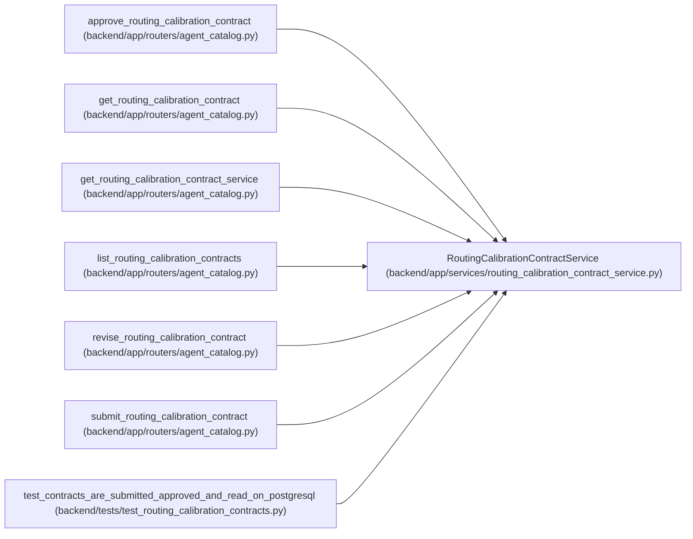

# RoutingCalibrationContractService

**Location:** `backend/app/services/routing_calibration_contract_service.py:64`
**Kind:** Class
**Bases:** —
**Module:** [routing_calibration_contract_service](../modules/routing_calibration_contract_service.md)

## Description

Read contracts and run their deployment-operator commands.

Writes use the model catalog's gate: the operator's admin key, or an agent
key whose actor holds the ``admin`` scope where the workspace's authority
mode lets an agent change deployment settings.

## Attributes

*No annotated attributes found.*

## Methods

| Method | Signature | Decorators | Description |
|--------|-----------|------------|-------------|
| `__init__` | `(db: AsyncSession)` | — | — |
| `_response` | `(row: RoutingCalibrationContract) -> RoutingCalibrationContractResponse` | `@staticmethod` | — |
| `_contract` | *(async)* `(key: str, *, for_update: bool = False) -> RoutingCalibrationContract \| None` | — | — |
| `list_contracts` | *(async)* `(actor: AgentActor) -> RoutingCalibrationContractListResponse` | — | List every contract and state whether any is approved. |
| `get_contract` | *(async)* `(actor: AgentActor, key: str) -> RoutingCalibrationContractDetail` | — | Read one contract with every revision it has had. |
| `_validated_terms` | *(async)* `(data: RoutingCalibrationContractTerms) -> RoutingCalibrationContractTerms` | — | Refuse unknown or retired keys and a bias review dated in the future. |
| `_record` | `(row: RoutingCalibrationContract, *, action: str, principal: AgentActor, command: AgentPlanningCommandContext, operation: str) -> TaskEvent` | — | — |
| `_result` | *(async)* `(row: RoutingCalibrationContract, event: TaskEvent) -> _MutationResult` | — | — |
| `_require_revision` | `(row: RoutingCalibrationContract, expected: int) -> None` | `@staticmethod` | — |
| `_concurrent_revision` | `(key: str) -> AgentModelConflictError` | `@staticmethod` | — |
| `_submitted_by` | `(row: RoutingCalibrationContract, principal: AgentActor) -> None` | — | — |
| `_target_id` | *(async)* `(key: str) -> int` | — | — |
| `submit` | *(async)* `(actor: AgentActor, data: RoutingCalibrationContractSubmit, *, command: AgentPlanningCommandContext) -> AgentModelMutationReceipt` | — | Submit a new contract; it stays unapproved until another principal approves it. |
| `revise` | *(async)* `(key: str, actor: AgentActor, data: RoutingCalibrationContractRevise, *, command: AgentPlanningCommandContext) -> AgentModelMutationReceipt` | — | Submit complete new terms as the next revision; an earlier approval lapses. |
| `approve` | *(async)* `(key: str, actor: AgentActor, data: RoutingCalibrationContractApprove, *, command: AgentPlanningCommandContext) -> AgentModelMutationReceipt` | — | Approve the submitted terms as their declared approver, recording who authenticated. |

## Relationships

<!-- Auto-generated relationship summary. Do not edit by hand. -->

### Summary

| Module | Methods | Attributes |
|---|---:|---|
| [routing_calibration_contract_service](../modules/routing_calibration_contract_service.md) | 15 | — |

### References

| Reference | Kind | Source | Call sites |
|---|---|---|---:|
| `approve_routing_calibration_contract` | type_reference | [agent_catalog](../modules/agent_catalog.md) | — |
| `get_routing_calibration_contract` | type_reference | [agent_catalog](../modules/agent_catalog.md) | — |
| `get_routing_calibration_contract_service` | call | [agent_catalog](../modules/agent_catalog.md) | 1 |
| `get_routing_calibration_contract_service` | type_reference | [agent_catalog](../modules/agent_catalog.md) | — |
| `list_routing_calibration_contracts` | type_reference | [agent_catalog](../modules/agent_catalog.md) | — |
| `revise_routing_calibration_contract` | type_reference | [agent_catalog](../modules/agent_catalog.md) | — |
| `submit_routing_calibration_contract` | type_reference | [agent_catalog](../modules/agent_catalog.md) | — |
| `test_contracts_are_submitted_approved_and_read_on_postgresql` | call | [test_routing_calibration_contracts](../modules/test_routing_calibration_contracts.md) | 1 |
