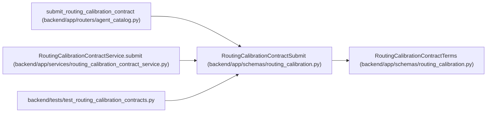

# RoutingCalibrationContractSubmit

**Location:** `backend/app/schemas/routing_calibration.py:159`
**Kind:** Pydantic model
**Bases:** `RoutingCalibrationContractTerms`
**Module:** [schemas_routing_calibration](../modules/schemas_routing_calibration.md)

## Description

Submit a new contract under a key that names no contract yet.

## Validators

| Method | Scope | Fields | Mode | Options |
|--------|-------|--------|------|---------|
| `normalize_key` | field | key | before | — |

## Attributes

| Name | Type | Wire name | Required | Nullable | Default | Constraints | Examples | Description |
|------|------|-----------|----------|----------|---------|-------------|-------------|----------|
| `key` | `RoutingKey` | `key` | Yes | No | — | — | — | — |

## Methods

| Method | Signature | Decorators | Description |
|--------|-----------|------------|-------------|
| `normalize_key` | `(value: object) -> object` | `@field_validator('key', mode='before')`, `@classmethod` | — |

## Relationships

<!-- Auto-generated relationship summary. Do not edit by hand. -->

### Summary

| Module | Methods | Attributes |
|---|---:|---|
| [schemas_routing_calibration](../modules/schemas_routing_calibration.md) | 1 | `key` |

### Structure

| Kind | Entity | Module |
|---|---|---|
| Base | `RoutingCalibrationContractTerms` | [schemas_routing_calibration](../modules/schemas_routing_calibration.md) |

### References

| Reference | Kind | Source | Call sites |
|---|---|---|---:|
| `submit_routing_calibration_contract` | type_reference | [agent_catalog](../modules/agent_catalog.md) | — |
| `RoutingCalibrationContractService.submit` | type_reference | [routing_calibration_contract_service](../modules/routing_calibration_contract_service.md) | — |
| `test_routing_calibration_contracts` | import | [test_routing_calibration_contracts](../modules/test_routing_calibration_contracts.md) | — |
