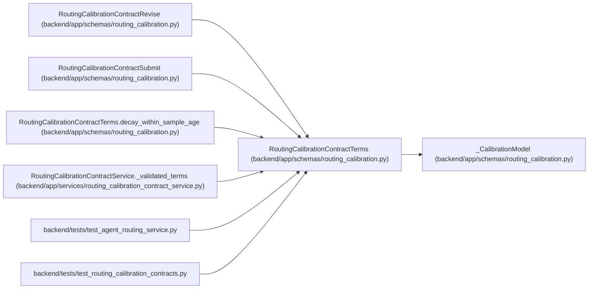

# RoutingCalibrationContractTerms

**Location:** `backend/app/schemas/routing_calibration.py:108`
**Kind:** Pydantic model
**Bases:** `_CalibrationModel`
**Module:** [schemas_routing_calibration](../modules/schemas_routing_calibration.md)

## Description

The complete terms of one contract revision; every field is required.

## Validators

| Method | Scope | Fields | Mode | Options |
|--------|-------|--------|------|---------|
| `normalize_keys` | field | qualification_keys | before | — |
| `unique_keys` | field | qualification_keys | after | — |
| `strip_approver` | field | approver | after | — |
| `decay_within_sample_age` | model | — | after | — |

## Attributes

| Name | Type | Wire name | Required | Nullable | Default | Constraints | Examples | Description |
|------|------|-----------|----------|----------|---------|-------------|-------------|----------|
| `qualification_keys` | `list[RoutingKey]` | `qualification_keys` | Yes | No | — | min_length=1; max_length=unknown (MAX_ROUTING_TAGS) | — | — |
| `sample_bounds` | `CalibrationSampleBounds` | `sample_bounds` | Yes | No | — | — | — | — |
| `decay` | `CalibrationDecay` | `decay` | Yes | No | — | — | — | — |
| `bias_review` | `CalibrationBiasReview` | `bias_review` | Yes | No | — | — | — | — |
| `approver` | `str` | `approver` | Yes | No | — | min_length=1; max_length=unknown (MAX_CALIBRATION_LABEL) | — | The accountable person or role whose approval the terms require. |

## Methods

| Method | Signature | Decorators | Description |
|--------|-----------|------------|-------------|
| `normalize_keys` | `(value: object) -> object` | `@field_validator('qualification_keys', mode='before')`, `@classmethod` | — |
| `unique_keys` | `(value: list[str]) -> list[str]` | `@field_validator('qualification_keys')`, `@classmethod` | — |
| `strip_approver` | `(value: str) -> str` | `@field_validator('approver')`, `@classmethod` | — |
| `decay_within_sample_age` | `() -> 'RoutingCalibrationContractTerms'` | `@model_validator(mode='after')` | — |
| `stored` | `() -> dict[str, Any]` | — | The canonical JSON form kept on the contract and its revisions. |
| `digest` | `() -> str` | — | SHA-256 over the canonical terms; an approval names the digest it read. |

## Relationships

<!-- Auto-generated relationship summary. Do not edit by hand. -->

### Summary

| Module | Methods | Attributes |
|---|---:|---|
| [schemas_routing_calibration](../modules/schemas_routing_calibration.md) | 6 | `approver`, `bias_review`, `decay`, `qualification_keys`, `sample_bounds` |

### Structure

| Kind | Entity | Module |
|---|---|---|
| Base | `_CalibrationModel` | [schemas_routing_calibration](../modules/schemas_routing_calibration.md) |
| Subclass | `RoutingCalibrationContractRevise` | [schemas_routing_calibration](../modules/schemas_routing_calibration.md) |
| Subclass | `RoutingCalibrationContractSubmit` | [schemas_routing_calibration](../modules/schemas_routing_calibration.md) |

### References

| Reference | Kind | Source | Call sites |
|---|---|---|---:|
| `RoutingCalibrationContractTerms.decay_within_sample_age` | type_reference | [schemas_routing_calibration](../modules/schemas_routing_calibration.md) | — |
| `RoutingCalibrationContractService._validated_terms` | type_reference | [routing_calibration_contract_service](../modules/routing_calibration_contract_service.md) | — |
| `test_agent_routing_service` | import | [test_agent_routing_service](../modules/test_agent_routing_service.md) | — |
| `test_routing_calibration_contracts` | import | [test_routing_calibration_contracts](../modules/test_routing_calibration_contracts.md) | — |
