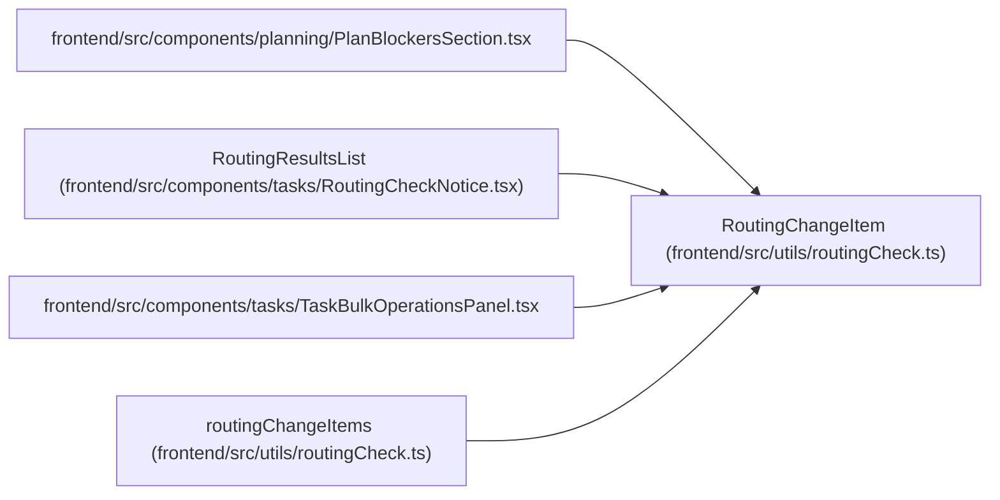

# RoutingChangeItem

**Location:** `frontend/src/utils/routingCheck.ts:60`
**Kind:** Interface
**Bases:** —
**Module:** [routingCheck](../modules/routingCheck.md)

## Description

One task of a bulk reassignment whose routing the suggestion would rewrite, or that has no suggestion.

## Attributes

| Name | Type | Required | Default | Description |
|------|------|----------|---------|-------------|
| `taskId` | `number` | Yes | — | — |
| `issues` | `RoutingIssue[]` | Yes | — | — |
| `before` | `TaskRouting \| null` | Yes | — | — |
| `after` | `TaskRouting \| null` | Yes | — | — |

## Methods

*No declared methods.*

## Relationships

<!-- Auto-generated relationship summary. Do not edit by hand. -->

### Summary

| Module | Methods | Attributes |
|---|---:|---|
| [routingCheck](../modules/routingCheck.md) | 0 | `after`, `before`, `issues`, `taskId` |

### References

| Reference | Kind | Source | Call sites |
|---|---|---|---:|
| `PlanBlockersSection` | import | [PlanBlockersSection](../modules/PlanBlockersSection.md) | — |
| `RoutingResultsList` | type_reference | [RoutingCheckNotice](../modules/RoutingCheckNotice.md) | — |
| `TaskBulkOperationsPanel` | import | [TaskBulkOperationsPanel](../modules/TaskBulkOperationsPanel.md) | — |
| `routingChangeItems` | type_reference | [routingCheck](../modules/routingCheck.md) | — |
