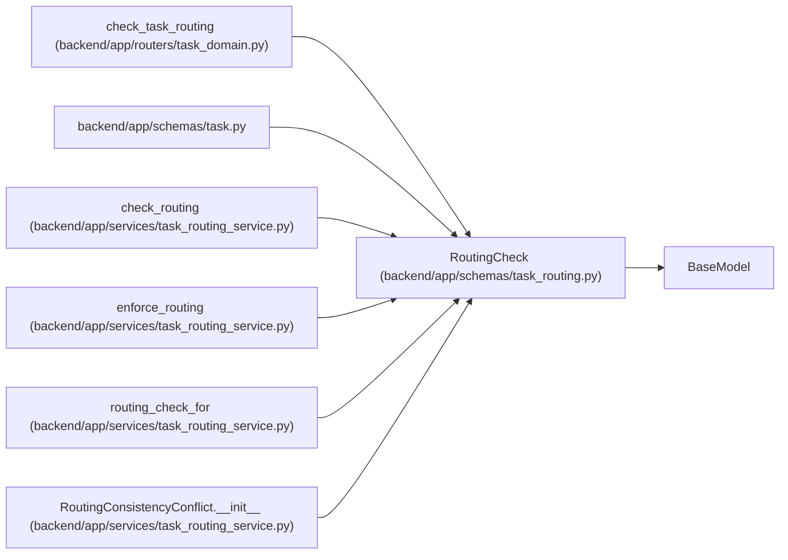

# RoutingCheck

**Location:** `backend/app/schemas/task_routing.py:82`
**Kind:** Pydantic model
**Bases:** `BaseModel`
**Module:** [task_routing](../modules/task_routing.md)

## Description

Routing consistency of one task for one assignee, with a consistent replacement.

## Attributes

| Name | Type | Wire name | Required | Nullable | Default | Constraints | Examples | Description |
|------|------|-----------|----------|----------|---------|-------------|-------------|----------|
| `task_id` | `int \| None` | `task_id` | No | Yes | `None` | — | — | — |
| `assignee_id` | `int \| None` | `assignee_id` | No | Yes | `None` | — | — | — |
| `assignee_profile_id` | `int \| None` | `assignee_profile_id` | No | Yes | `None` | — | — | — |
| `assignee_publishers` | `list[str]` | `assignee_publishers` | No | No | factory: `list` | — | — | — |
| `assignee_catalog_keys` | `list[str]` | `assignee_catalog_keys` | No | No | factory: `list` | — | — | — |
| `different_publisher_required` | `bool` | `different_publisher_required` | No | No | `False` | — | — | — |
| `conflict_mode` | `RoutingConflictMode` | `conflict_mode` | No | No | `'refuse'` | — | — | — |
| `structured` | `bool` | `structured` | No | No | `False` | — | — | The routing is stored as structure in the brief. |
| `text_routing` | `bool` | `text_routing` | No | No | `False` | — | — | The brief names routing only in free text; convert it to check it. |
| `consistent` | `bool` | `consistent` | No | No | `True` | — | — | — |
| `issues` | `list[RoutingIssue]` | `issues` | No | No | factory: `list` | — | — | — |
| `routing` | `TaskRouting \| None` | `routing` | No | Yes | `None` | — | — | The routing that was checked. |
| `suggestion` | `TaskRouting \| None` | `suggestion` | No | Yes | `None` | — | — | A routing consistent with the assignee and policy, when it differs. |
| `suggested_reviewer` | `RoutingReviewer \| None` | `suggested_reviewer` | No | Yes | `None` | — | — | — |
| `applied` | `bool` | `applied` | No | No | `False` | — | — | The suggestion was saved with this change. |

## Methods

*No declared methods.*

## Relationships

<!-- Auto-generated relationship summary. Do not edit by hand. -->

### Summary

| Module | Methods | Attributes |
|---|---:|---|
| [task_routing](../modules/task_routing.md) | 0 | `applied`, `assignee_catalog_keys`, `assignee_id`, `assignee_profile_id`, `assignee_publishers`, `conflict_mode`, `consistent`, `different_publisher_required`, `issues`, `routing`, `structured`, `suggested_reviewer` |

### Structure

| Kind | Entity | Module |
|---|---|---|
| Base | `BaseModel` | — |

### References

| Reference | Kind | Source | Call sites |
|---|---|---|---:|
| `check_task_routing` | type_reference | [routers_task_domain](../modules/routers_task_domain.md) | — |
| `task` | import | [schemas_task](../modules/schemas_task.md) | — |
| `check_routing` | call | [task_routing_service](../modules/task_routing_service.md) | 2 |
| `check_routing` | type_reference | [task_routing_service](../modules/task_routing_service.md) | — |
| `enforce_routing` | type_reference | [task_routing_service](../modules/task_routing_service.md) | — |
| `routing_check_for` | type_reference | [task_routing_service](../modules/task_routing_service.md) | — |
| `RoutingConsistencyConflict.__init__` | type_reference | [task_routing_service](../modules/task_routing_service.md) | — |
