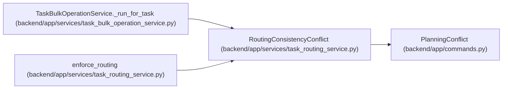

# RoutingConsistencyConflict

**Location:** `backend/app/services/task_routing_service.py:29`
**Kind:** Class
**Bases:** `PlanningConflict`
**Module:** [task_routing_service](../modules/task_routing_service.md)

## Description

A routing change refused under the project's policy; the detail carries a consistent routing.

## Attributes

*No annotated attributes found.*

## Methods

| Method | Signature | Decorators | Description |
|--------|-----------|------------|-------------|
| `__init__` | `(check: RoutingCheck)` | — | — |
| `detail` | `()` | — | — |

## Relationships

<!-- Auto-generated relationship summary. Do not edit by hand. -->

### Summary

| Module | Methods | Attributes |
|---|---:|---|
| [task_routing_service](../modules/task_routing_service.md) | 2 | — |

### Structure

| Kind | Entity | Module |
|---|---|---|
| Base | `PlanningConflict` | [commands](../modules/commands.md) |

### References

| Reference | Kind | Source | Call sites |
|---|---|---|---:|
| `TaskBulkOperationService._run_for_task` | call | [task_bulk_operation_service](../modules/task_bulk_operation_service.md) | 1 |
| `enforce_routing` | call | [task_routing_service](../modules/task_routing_service.md) | 1 |
