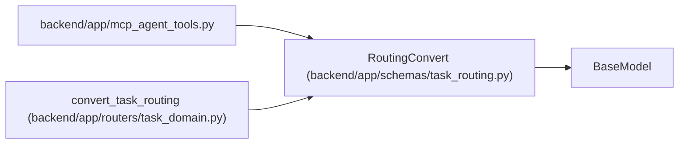

# RoutingConvert

**Location:** `backend/app/schemas/task_routing.py:102`
**Kind:** Pydantic model
**Bases:** `BaseModel`
**Module:** [task_routing](../modules/task_routing.md)

## Description

Preview or apply the conversion of free-text routing into structure.

## Model Configuration

| Setting | Value | Source |
|---------|-------|--------|
| `extra` | `'forbid'` | model_config |

## Attributes

| Name | Type | Wire name | Required | Nullable | Default | Constraints | Examples | Description |
|------|------|-----------|----------|----------|---------|-------------|-------------|----------|
| `expected_version` | `int` | `expected_version` | Yes | No | — | ge=1 | — | — |
| `apply` | `bool` | `apply` | No | No | `False` | — | — | — |
| `routing` | `TaskRouting \| None` | `routing` | No | Yes | `None` | — | — | Routing that replaces what the conversion parsed, for example to settle an ambiguous model. |

## Methods

*No declared methods.*

## Relationships

<!-- Auto-generated relationship summary. Do not edit by hand. -->

### Summary

| Module | Methods | Attributes |
|---|---:|---|
| [task_routing](../modules/task_routing.md) | 0 | `apply`, `expected_version`, `routing` |

### Structure

| Kind | Entity | Module |
|---|---|---|
| Base | `BaseModel` | — |

### References

| Reference | Kind | Source | Call sites |
|---|---|---|---:|
| `mcp_agent_tools` | import | [mcp_agent_tools](../modules/mcp_agent_tools.md) | — |
| `convert_task_routing` | type_reference | [routers_task_domain](../modules/routers_task_domain.md) | — |
