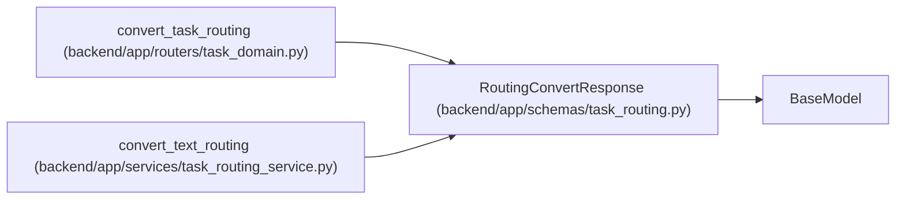

# RoutingConvertResponse

**Location:** `backend/app/schemas/task_routing.py:112`
**Kind:** Pydantic model
**Bases:** `BaseModel`
**Module:** [task_routing](../modules/task_routing.md)

## Description

Result of a routing conversion preview or apply.

## Attributes

| Name | Type | Wire name | Required | Nullable | Default | Constraints | Examples | Description |
|------|------|-----------|----------|----------|---------|-------------|-------------|----------|
| `task_id` | `int` | `task_id` | Yes | No | — | — | — | — |
| `already_structured` | `bool` | `already_structured` | No | No | `False` | — | — | — |
| `applied` | `bool` | `applied` | No | No | `False` | — | — | — |
| `routing` | `TaskRouting \| None` | `routing` | No | Yes | `None` | — | — | — |
| `brief` | `dict \| None` | `brief` | No | Yes | `None` | — | — | — |
| `removed` | `list[str]` | `removed` | No | No | factory: `list` | — | — | Sentences the structured routing replaces. |
| `unresolved` | `list[str]` | `unresolved` | No | No | factory: `list` | — | — | Routing sentences kept as text because no single catalog entry matched. |
| `check` | `RoutingCheck \| None` | `check` | No | Yes | `None` | — | — | — |
| `resets_progress` | `bool` | `resets_progress` | No | No | `False` | — | — | Applying edits the brief's text, which creates a brief revision and clears the task's current criterion progress. |
| `task_version` | `int \| None` | `task_version` | No | Yes | `None` | — | — | — |

## Methods

*No declared methods.*

## Relationships

<!-- Auto-generated relationship summary. Do not edit by hand. -->

### Summary

| Module | Methods | Attributes |
|---|---:|---|
| [task_routing](../modules/task_routing.md) | 0 | `already_structured`, `applied`, `brief`, `check`, `removed`, `resets_progress`, `routing`, `task_id`, `task_version`, `unresolved` |

### Structure

| Kind | Entity | Module |
|---|---|---|
| Base | `BaseModel` | — |

### References

| Reference | Kind | Source | Call sites |
|---|---|---|---:|
| `convert_task_routing` | type_reference | [routers_task_domain](../modules/routers_task_domain.md) | — |
| `convert_text_routing` | call | [task_routing_service](../modules/task_routing_service.md) | 2 |
| `convert_text_routing` | type_reference | [task_routing_service](../modules/task_routing_service.md) | — |
