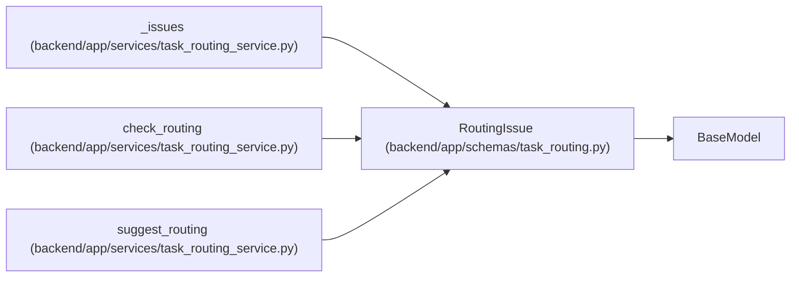

# RoutingIssue

**Location:** `backend/app/schemas/task_routing.py:71`
**Kind:** Pydantic model
**Bases:** `BaseModel`
**Module:** [task_routing](../modules/task_routing.md)

## Description

One inconsistency between a task's routing, its assignee and the project policy.

## Attributes

| Name | Type | Wire name | Required | Nullable | Default | Constraints | Examples | Description |
|------|------|-----------|----------|----------|---------|-------------|-------------|----------|
| `code` | `str` | `code` | Yes | No | — | — | — | — |
| `severity` | `Literal['conflict', 'warning']` | `severity` | Yes | No | — | — | — | — |
| `field` | `Literal['first_rung', 'escalation', 'reviewer', 'assignee', 'routing']` | `field` | Yes | No | — | — | — | — |
| `message` | `str` | `message` | Yes | No | — | — | — | — |
| `catalog_key` | `str \| None` | `catalog_key` | No | Yes | `None` | — | — | — |
| `publisher_key` | `str \| None` | `publisher_key` | No | Yes | `None` | — | — | — |

## Methods

*No declared methods.*

## Relationships

<!-- Auto-generated relationship summary. Do not edit by hand. -->

### Summary

| Module | Methods | Attributes |
|---|---:|---|
| [task_routing](../modules/task_routing.md) | 0 | `catalog_key`, `code`, `field`, `message`, `publisher_key`, `severity` |

### Structure

| Kind | Entity | Module |
|---|---|---|
| Base | `BaseModel` | — |

### References

| Reference | Kind | Source | Call sites |
|---|---|---|---:|
| `_issues` | type_reference | [task_routing_service](../modules/task_routing_service.md) | — |
| `check_routing` | call | [task_routing_service](../modules/task_routing_service.md) | 2 |
| `suggest_routing` | call | [task_routing_service](../modules/task_routing_service.md) | 2 |
| `suggest_routing` | type_reference | [task_routing_service](../modules/task_routing_service.md) | — |
