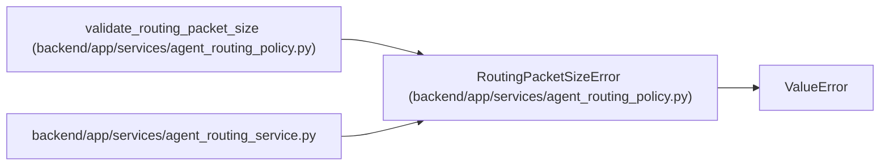

# RoutingPacketSizeError

**Location:** `backend/app/services/agent_routing_policy.py:1141`
**Kind:** Class
**Bases:** `ValueError`
**Module:** [agent_routing_policy](../modules/agent_routing_policy.md)

## Description

The canonical UTF-8 representation exceeds its routing boundary.

This validation error identifies a canonical routing packet that exceeds the byte budget. Preview construction handles this error only for the complete response and retains normal validation for individual candidates and exclusions.

## Attributes

*No annotated attributes found.*

## Methods

*No declared methods.*

## Relationships

<!-- Auto-generated relationship summary. Do not edit by hand. -->

### Summary

| Module | Methods | Attributes |
|---|---:|---|
| [agent_routing_policy](../modules/agent_routing_policy.md) | 0 | — |

### Structure

| Kind | Entity | Module |
|---|---|---|
| Base | `ValueError` | — |

### References

| Reference | Kind | Source | Call sites |
|---|---|---|---:|
| `validate_routing_packet_size` | call | [agent_routing_policy](../modules/agent_routing_policy.md) | 1 |
| `agent_routing_service` | import | [agent_routing_service](../modules/agent_routing_service.md) | — |
