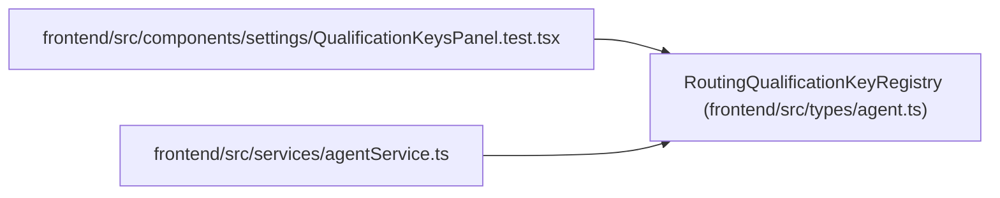

# RoutingQualificationKeyRegistry

**Location:** `frontend/src/types/agent.ts:355`
**Kind:** Interface
**Bases:** —
**Module:** [types_agent](../modules/types_agent.md)

## Description

_Auto-generated from `RoutingQualificationKeyRegistry` in `frontend/src/types/agent.ts`._

## Attributes

| Name | Type | Required | Default | Description |
|------|------|----------|---------|-------------|
| `builtin_keys` | `string[]` | Yes | — | — |
| `keys` | `RoutingQualificationKey[]` | Yes | — | — |

## Methods

*No declared methods.*

## Relationships

<!-- Auto-generated relationship summary. Do not edit by hand. -->

### Summary

| Module | Methods | Attributes |
|---|---:|---|
| [types_agent](../modules/types_agent.md) | 0 | `builtin_keys`, `keys` |

### References

| Reference | Kind | Source | Call sites |
|---|---|---|---:|
| `QualificationKeysPanel.test` | import | [QualificationKeysPanel.test](../modules/QualificationKeysPanel.test.md) | — |
| `agentService` | import | [agentService](../modules/agentService.md) | — |
