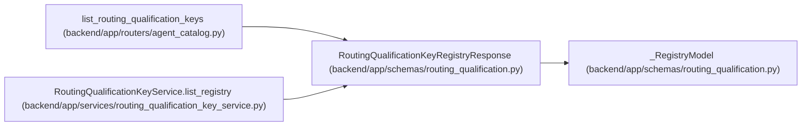

# RoutingQualificationKeyRegistryResponse

**Location:** `backend/app/schemas/routing_qualification.py:160`
**Kind:** Pydantic model
**Bases:** `_RegistryModel`
**Module:** [schemas_routing_qualification](../modules/schemas_routing_qualification.md)

## Description

The built-in keys routing always accepts, and the deployment's declared keys.

## Attributes

| Name | Type | Wire name | Required | Nullable | Default | Constraints | Examples | Description |
|------|------|-----------|----------|----------|---------|-------------|-------------|----------|
| `builtin_keys` | `list[str]` | `builtin_keys` | Yes | No | — | — | — | — |
| `keys` | `list[RoutingQualificationKeyResponse]` | `keys` | Yes | No | — | — | — | — |

## Methods

*No declared methods.*

## Relationships

<!-- Auto-generated relationship summary. Do not edit by hand. -->

### Summary

| Module | Methods | Attributes |
|---|---:|---|
| [schemas_routing_qualification](../modules/schemas_routing_qualification.md) | 0 | `builtin_keys`, `keys` |

### Structure

| Kind | Entity | Module |
|---|---|---|
| Base | `_RegistryModel` | [schemas_routing_qualification](../modules/schemas_routing_qualification.md) |

### References

| Reference | Kind | Source | Call sites |
|---|---|---|---:|
| `list_routing_qualification_keys` | type_reference | [agent_catalog](../modules/agent_catalog.md) | — |
| `RoutingQualificationKeyService.list_registry` | call | [routing_qualification_key_service](../modules/routing_qualification_key_service.md) | 1 |
| `RoutingQualificationKeyService.list_registry` | type_reference | [routing_qualification_key_service](../modules/routing_qualification_key_service.md) | — |
