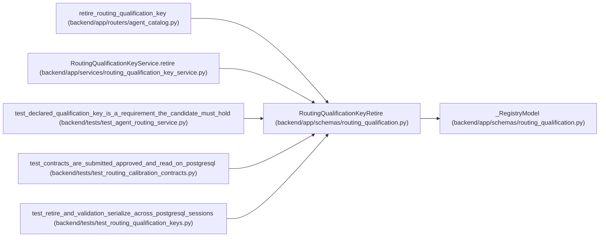

# RoutingQualificationKeyRetire

**Location:** `backend/app/schemas/routing_qualification.py:89`
**Kind:** Pydantic model
**Bases:** `_RegistryModel`
**Module:** [schemas_routing_qualification](../modules/schemas_routing_qualification.md)

## Description

Retire an active key that no catalog entry or current task requirement names.

## Attributes

| Name | Type | Wire name | Required | Nullable | Default | Constraints | Examples | Description |
|------|------|-----------|----------|----------|---------|-------------|-------------|----------|
| `expected_revision` | `PositiveRevision` | `expected_revision` | Yes | No | — | — | — | — |

## Methods

*No declared methods.*

## Relationships

<!-- Auto-generated relationship summary. Do not edit by hand. -->

### Summary

| Module | Methods | Attributes |
|---|---:|---|
| [schemas_routing_qualification](../modules/schemas_routing_qualification.md) | 0 | `expected_revision` |

### Structure

| Kind | Entity | Module |
|---|---|---|
| Base | `_RegistryModel` | [schemas_routing_qualification](../modules/schemas_routing_qualification.md) |

### References

| Reference | Kind | Source | Call sites |
|---|---|---|---:|
| `retire_routing_qualification_key` | type_reference | [agent_catalog](../modules/agent_catalog.md) | — |
| `RoutingQualificationKeyService.retire` | type_reference | [routing_qualification_key_service](../modules/routing_qualification_key_service.md) | — |
| `test_declared_qualification_key_is_a_requirement_the_candidate_must_hold` | call | [test_agent_routing_service](../modules/test_agent_routing_service.md) | 1 |
| `test_contracts_are_submitted_approved_and_read_on_postgresql` | call | [test_routing_calibration_contracts](../modules/test_routing_calibration_contracts.md) | 1 |
| `test_retire_and_validation_serialize_across_postgresql_sessions` | call | [test_routing_qualification_keys](../modules/test_routing_qualification_keys.md) | 1 |
