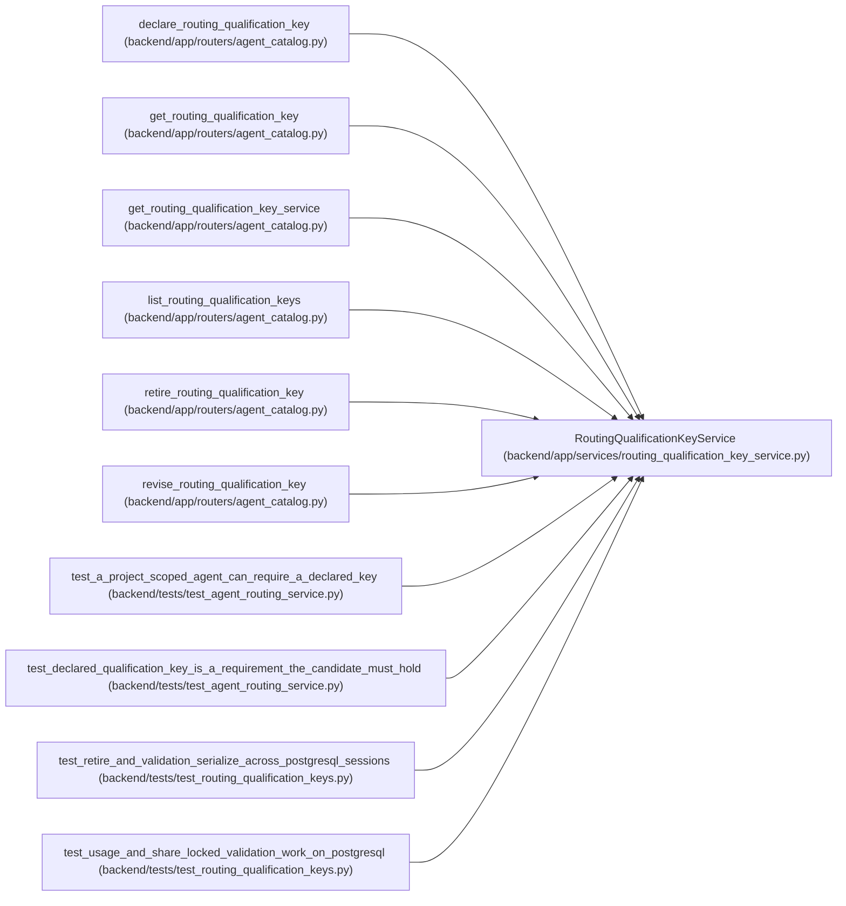

# RoutingQualificationKeyService

**Location:** `backend/app/services/routing_qualification_key_service.py:133`
**Kind:** Class
**Bases:** —
**Module:** [routing_qualification_key_service](../modules/routing_qualification_key_service.md)

## Description

Read the registry and run its deployment-operator commands.

Writes use the same gate as the model catalog: the operator's admin key,
or an agent key whose actor holds the ``admin`` scope where the workspace's
authority mode lets an agent change deployment settings.

## Attributes

*No annotated attributes found.*

## Methods

| Method | Signature | Decorators | Description |
|--------|-----------|------------|-------------|
| `__init__` | `(db: AsyncSession)` | — | — |
| `_response` | `(row: RoutingQualificationKey) -> RoutingQualificationKeyResponse` | `@staticmethod` | — |
| `_key` | *(async)* `(key: str, *, for_update: bool = False) -> RoutingQualificationKey \| None` | — | — |
| `list_registry` | *(async)* `(actor: AgentActor, *, include_retired: bool = False) -> RoutingQualificationKeyRegistryResponse` | — | List the built-in keys and the declared keys, active ones by default. |
| `get_key` | *(async)* `(actor: AgentActor, key: str) -> RoutingQualificationKeyDetail` | — | Read one declared key with its revisions and what currently names it. |
| `usage` | *(async)* `(key: str) -> RoutingQualificationKeyUsage` | — | Catalog entries holding the key and open tasks requiring it, as visible to the caller. |
| `_references` | *(async)* `(key: str) -> tuple[list[AgentModelCatalogEntry], list[int]]` | — | — |
| `_bounded_usage` | `(entries: list[AgentModelCatalogEntry], task_ids: list[int], *, total_entries: int \| None = None, total_tasks: int \| None = None) -> RoutingQualificationKeyUsage` | `@staticmethod` | — |
| `_retire_usage` | *(async)* `(key: str) -> RoutingQualificationKeyUsage` | — | Usage that decides a retire: every reference counts, but only visible tasks are named. |
| `_record` | `(row: RoutingQualificationKey, *, action: str, principal: AgentActor, command: AgentPlanningCommandContext, operation: str) -> TaskEvent` | — | — |
| `_result` | *(async)* `(row: RoutingQualificationKey, event: TaskEvent) -> _MutationResult` | — | — |
| `_require_revision` | `(row: RoutingQualificationKey, expected: int) -> None` | `@staticmethod` | — |
| `declare` | *(async)* `(actor: AgentActor, data: RoutingQualificationKeyDeclare, *, command: AgentPlanningCommandContext) -> AgentModelMutationReceipt` | — | Declare a key, or bring back a retired one as its next revision. |
| `_concurrent_revision` | `(key: str) -> AgentModelConflictError` | `@staticmethod` | — |
| `_target_id` | *(async)* `(key: str) -> int` | — | — |
| `revise` | *(async)* `(key: str, actor: AgentActor, data: RoutingQualificationKeyRevise, *, command: AgentPlanningCommandContext) -> AgentModelMutationReceipt` | — | Change an active key's label or description as its next revision. |
| `retire` | *(async)* `(key: str, actor: AgentActor, data: RoutingQualificationKeyRetire, *, command: AgentPlanningCommandContext) -> AgentModelMutationReceipt` | — | Retire a key that no catalog entry or open task requirement names. |

## Relationships

<!-- Auto-generated relationship summary. Do not edit by hand. -->

### Summary

| Module | Methods | Attributes |
|---|---:|---|
| [routing_qualification_key_service](../modules/routing_qualification_key_service.md) | 17 | — |

### References

| Reference | Kind | Source | Call sites |
|---|---|---|---:|
| `declare_routing_qualification_key` | type_reference | [agent_catalog](../modules/agent_catalog.md) | — |
| `get_routing_qualification_key` | type_reference | [agent_catalog](../modules/agent_catalog.md) | — |
| `get_routing_qualification_key_service` | call | [agent_catalog](../modules/agent_catalog.md) | 1 |
| `get_routing_qualification_key_service` | type_reference | [agent_catalog](../modules/agent_catalog.md) | — |
| `list_routing_qualification_keys` | type_reference | [agent_catalog](../modules/agent_catalog.md) | — |
| `retire_routing_qualification_key` | type_reference | [agent_catalog](../modules/agent_catalog.md) | — |
| `revise_routing_qualification_key` | type_reference | [agent_catalog](../modules/agent_catalog.md) | — |
| `test_a_project_scoped_agent_can_require_a_declared_key` | call | [test_agent_routing_service](../modules/test_agent_routing_service.md) | 2 |
| `test_declared_qualification_key_is_a_requirement_the_candidate_must_hold` | call | [test_agent_routing_service](../modules/test_agent_routing_service.md) | 1 |
| `test_retire_and_validation_serialize_across_postgresql_sessions` | call | [test_routing_qualification_keys](../modules/test_routing_qualification_keys.md) | 2 |
| `test_usage_and_share_locked_validation_work_on_postgresql` | call | [test_routing_qualification_keys](../modules/test_routing_qualification_keys.md) | 1 |
