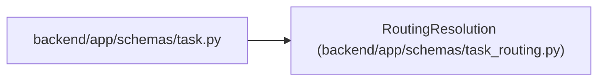

# RoutingResolution

**Location:** `backend/app/schemas/task_routing.py:13`
**Kind:** Type alias
**Bases:** —
**Module:** [task_routing](../modules/task_routing.md)
**Target:** `Literal['check', 'apply_suggestion']`

## Description

_Auto-generated from `RoutingResolution` in `backend/app/schemas/task_routing.py`._

## Attributes

*See the alias definition for its member types.*

## Methods

*See the alias definition for callable and member types.*

## Relationships

<!-- Auto-generated relationship summary. Do not edit by hand. -->

### Summary

| Module | Methods | Attributes |
|---|---:|---|
| [task_routing](../modules/task_routing.md) | 0 | — |

### References

| Reference | Kind | Source | Call sites |
|---|---|---|---:|
| `task` | import | [schemas_task](../modules/schemas_task.md) | — |
