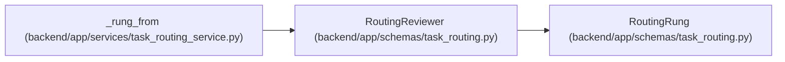

# RoutingReviewer

**Location:** `backend/app/schemas/task_routing.py:35`
**Kind:** Pydantic model
**Bases:** `RoutingRung`
**Module:** [task_routing](../modules/task_routing.md)

## Description

The model that reviews the task's result, and optionally the reviewer profile to dispatch.

## Attributes

| Name | Type | Wire name | Required | Nullable | Default | Constraints | Examples | Description |
|------|------|-----------|----------|----------|---------|-------------|-------------|----------|
| `profile_id` | `int \| None` | `profile_id` | No | Yes | `None` | ge=1 | — | Reviewer profile passed as reviewer_profile_id at dispatch. |
| `instructions` | `str` | `instructions` | No | No | `''` | max_length=2000 | — | What the review checks, for example each criterion against its evidence. |

## Methods

*No declared methods.*

## Relationships

<!-- Auto-generated relationship summary. Do not edit by hand. -->

### Summary

| Module | Methods | Attributes |
|---|---:|---|
| [task_routing](../modules/task_routing.md) | 0 | `instructions`, `profile_id` |

### Structure

| Kind | Entity | Module |
|---|---|---|
| Base | `RoutingRung` | [task_routing](../modules/task_routing.md) |

### References

| Reference | Kind | Source | Call sites |
|---|---|---|---:|
| `_rung_from` | call | [task_routing_service](../modules/task_routing_service.md) | 1 |
