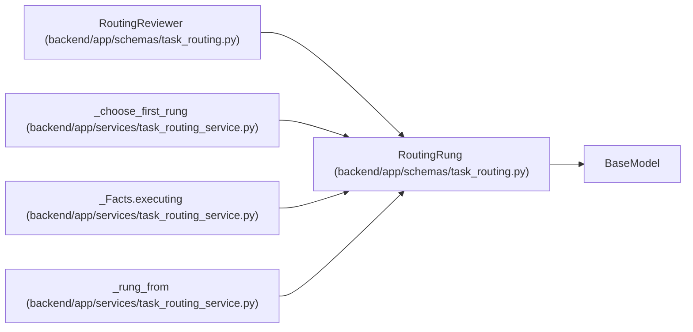

# RoutingRung

**Location:** `backend/app/schemas/task_routing.py:16`
**Kind:** Pydantic model
**Bases:** `BaseModel`
**Module:** [task_routing](../modules/task_routing.md)

## Description

One model catalog entry that may execute the task.

## Model Configuration

| Setting | Value | Source |
|---------|-------|--------|
| `extra` | `'forbid'` | model_config |

## Validators

| Method | Scope | Fields | Mode | Options |
|--------|-------|--------|------|---------|
| `canonical_key` | field | catalog_key | after | — |

## Attributes

| Name | Type | Wire name | Required | Nullable | Default | Constraints | Examples | Description |
|------|------|-----------|----------|----------|---------|-------------|-------------|----------|
| `catalog_key` | `str` | `catalog_key` | Yes | No | — | max_length=120; min_length=1 | — | Key of a model catalog entry. |
| `harness` | `str` | `harness` | No | No | `''` | max_length=120 | — | Where the model runs, for people, such as an agent client name. |
| `effort` | `str \| None` | `effort` | No | Yes | `None` | max_length=20 | — | Filled by the server from the catalog entry. |
| `publisher_key` | `str \| None` | `publisher_key` | No | Yes | `None` | max_length=120 | — | Filled by the server from the catalog entry. |
| `configured_model_alias` | `str \| None` | `configured_model_alias` | No | Yes | `None` | max_length=255 | — | Filled by the server from the catalog entry. |

## Methods

| Method | Signature | Decorators | Description |
|--------|-----------|------------|-------------|
| `canonical_key` | `(value: str) -> str` | `@field_validator('catalog_key')`, `@classmethod` | — |

## Relationships

<!-- Auto-generated relationship summary. Do not edit by hand. -->

### Summary

| Module | Methods | Attributes |
|---|---:|---|
| [task_routing](../modules/task_routing.md) | 1 | `catalog_key`, `configured_model_alias`, `effort`, `harness`, `publisher_key` |

### Structure

| Kind | Entity | Module |
|---|---|---|
| Base | `BaseModel` | — |
| Subclass | `RoutingReviewer` | [task_routing](../modules/task_routing.md) |

### References

| Reference | Kind | Source | Call sites |
|---|---|---|---:|
| `_choose_first_rung` | type_reference | [task_routing_service](../modules/task_routing_service.md) | — |
| `_Facts.executing` | type_reference | [task_routing_service](../modules/task_routing_service.md) | — |
| `_rung_from` | call | [task_routing_service](../modules/task_routing_service.md) | 1 |
