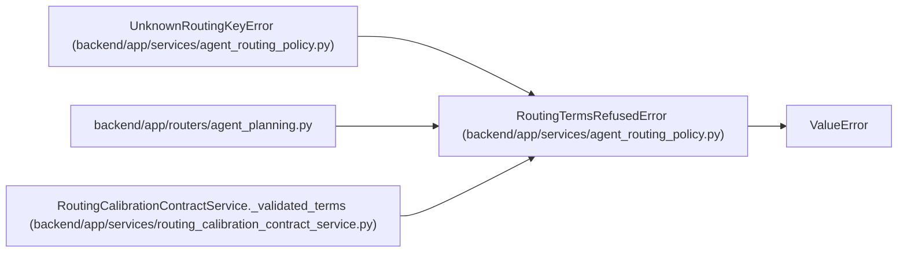

# RoutingTermsRefusedError

**Location:** `backend/app/services/agent_routing_policy.py:492`
**Kind:** Class
**Bases:** `ValueError`
**Module:** [agent_routing_policy](../modules/agent_routing_policy.md)

## Description

Routing terms that pass request validation but name something the server refuses.

REST maps it to the same 422 response request validation gives.

## Attributes

*No annotated attributes found.*

## Methods

*No declared methods.*

## Relationships

<!-- Auto-generated relationship summary. Do not edit by hand. -->

### Summary

| Module | Methods | Attributes |
|---|---:|---|
| [agent_routing_policy](../modules/agent_routing_policy.md) | 0 | — |

### Structure

| Kind | Entity | Module |
|---|---|---|
| Base | `ValueError` | — |
| Subclass | `UnknownRoutingKeyError` | [agent_routing_policy](../modules/agent_routing_policy.md) |

### References

| Reference | Kind | Source | Call sites |
|---|---|---|---:|
| `agent_planning` | import | [routers_agent_planning](../modules/routers_agent_planning.md) | — |
| `RoutingCalibrationContractService._validated_terms` | call | [routing_calibration_contract_service](../modules/routing_calibration_contract_service.md) | 1 |
