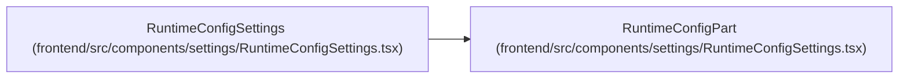

# RuntimeConfigPart

**Location:** `frontend/src/components/settings/RuntimeConfigSettings.tsx:61`
**Kind:** Type alias
**Bases:** —
**Module:** [RuntimeConfigSettings](../modules/RuntimeConfigSettings.md)
**Target:**

```typescript
'aiLanguage' | 'llm' | 'github' | 'webIntake' | 'restart'
```

## Description

The parts of the saved server configuration that one Settings section shows.

## Attributes

*See the alias definition for its member types.*

## Methods

*See the alias definition for callable and member types.*

## Relationships

<!-- Auto-generated relationship summary. Do not edit by hand. -->


### Summary

| Module | Methods | Attributes |
|---|---:|---|
| [RuntimeConfigSettings](../modules/RuntimeConfigSettings.md) | 0 | — |

### References

| Reference | Kind | Source | Call sites |
|---|---|---|---:|
| `RuntimeConfigSettings` | type_reference | [RuntimeConfigSettings](../modules/RuntimeConfigSettings.md) | — |
