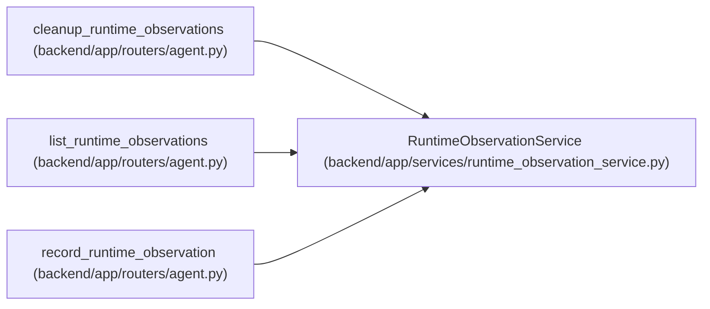

# RuntimeObservationService

**Location:** `backend/app/services/runtime_observation_service.py:26`
**Kind:** Class
**Bases:** —
**Module:** [runtime_observation_service](../modules/runtime_observation_service.md)

## Description

_Auto-generated from `RuntimeObservationService` in `backend/app/services/runtime_observation_service.py`._

## Attributes

*No annotated attributes found.*

## Methods

| Method | Signature | Decorators | Description |
|--------|-----------|------------|-------------|
| `__init__` | `(db)` | — | — |
| `_writer` | `()` | — | — |
| `_references` | *(async)* `(authority, data: AgentRuntimeObservationCreate)` | — | Resolve the task a row is filed under; references must be visible to the observer. |
| `record` | *(async)* `(data: AgentRuntimeObservationCreate)` | — | Append one observation; repeating the same key and content returns the first row. |
| `list` | *(async)* `(*, task_id = None, run_id = None, harness_kind = None, harness_session_id = None, limit = 100)` | — | Observations this reader can see: the request's task read scope applies. |
| `cleanup` | *(async)* `(*, limit = 500)` | — | Remove a bounded batch of observations older than the retention period. |

## Relationships

<!-- Auto-generated relationship summary. Do not edit by hand. -->

### Summary

| Module | Methods | Attributes |
|---|---:|---|
| [runtime_observation_service](../modules/runtime_observation_service.md) | 6 | — |

### References

| Reference | Kind | Source | Call sites |
|---|---|---|---:|
| `cleanup_runtime_observations` | call | [routers_agent](../modules/routers_agent.md) | 1 |
| `list_runtime_observations` | call | [routers_agent](../modules/routers_agent.md) | 1 |
| `record_runtime_observation` | call | [routers_agent](../modules/routers_agent.md) | 1 |
