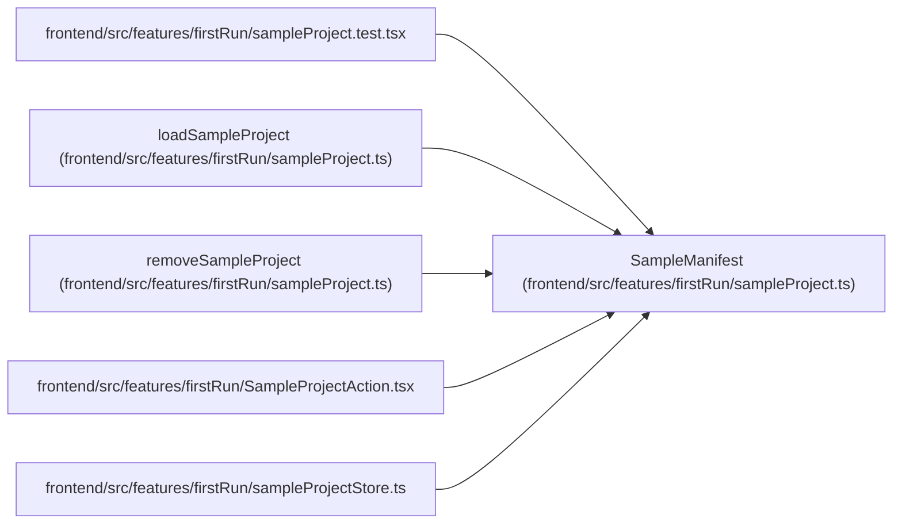

# SampleManifest

**Location:** `frontend/src/features/firstRun/sampleProject.ts:13`
**Kind:** Interface
**Bases:** —
**Module:** [sampleProject](../modules/sampleProject.md)

## Description

_Auto-generated from `SampleManifest` in `frontend/src/features/firstRun/sampleProject.ts`._

## Attributes

| Name | Type | Required | Default | Description |
|------|------|----------|---------|-------------|
| `owner` | `string` | Yes | — | — |
| `records` | `SampleRecord[]` | Yes | — | — |
| `complete` | `boolean` | Yes | — | — |
| `previousScope` | `WorkScope` | No | — | — |

## Methods

*No declared methods.*

## Relationships

<!-- Auto-generated relationship summary. Do not edit by hand. -->

### Summary

| Module | Methods | Attributes |
|---|---:|---|
| [sampleProject](../modules/sampleProject.md) | 0 | `complete`, `owner`, `previousScope`, `records` |

### References

| Reference | Kind | Source | Call sites |
|---|---|---|---:|
| `sampleProject.test` | import | [sampleProject.test](../modules/sampleProject.test.md) | — |
| `loadSampleProject` | type_reference | [sampleProject](../modules/sampleProject.md) | — |
| `removeSampleProject` | type_reference | [sampleProject](../modules/sampleProject.md) | — |
| `SampleProjectAction` | import | [SampleProjectAction](../modules/SampleProjectAction.md) | — |
| `sampleProjectStore` | import | [sampleProjectStore](../modules/sampleProjectStore.md) | — |
