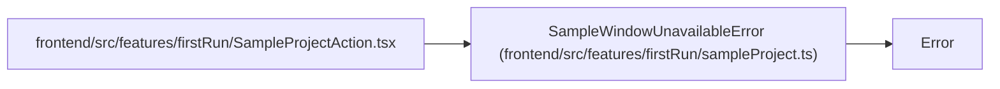

# SampleWindowUnavailableError

**Location:** `frontend/src/features/firstRun/sampleProject.ts:15`
**Kind:** Class
**Bases:** `Error`
**Module:** [sampleProject](../modules/sampleProject.md)

## Description

_Auto-generated from `SampleWindowUnavailableError` in `frontend/src/features/firstRun/sampleProject.ts`._

## Attributes

*No annotated attributes found.*

## Methods

*No declared methods.*

## Relationships

<!-- Auto-generated relationship summary. Do not edit by hand. -->

### Summary

| Module | Methods | Attributes |
|---|---:|---|
| [sampleProject](../modules/sampleProject.md) | 0 | — |

### Structure

| Kind | Entity | Module |
|---|---|---|
| Base | `Error` | — |

### References

| Reference | Kind | Source | Call sites |
|---|---|---|---:|
| `SampleProjectAction` | import | [SampleProjectAction](../modules/SampleProjectAction.md) | — |
