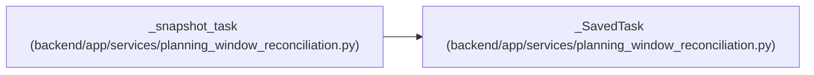

# _SavedTask

**Location:** `backend/app/services/planning_window_reconciliation.py:46`
**Kind:** Class
**Bases:** —
**Module:** [planning_window_reconciliation](../modules/planning_window_reconciliation.md)

**Decorators:** `@dataclass(frozen=True)`

## Description

_Auto-generated from `_SavedTask` in `backend/app/services/planning_window_reconciliation.py`._

A verified task projection stores its prior version, the digests of the task and iteration scope, and the earlier end date. Polls can reuse it only for the same current snapshot bytes. An owning command validates the canonical payload again.

## Attributes

| Name | Type | Default | Description |
|------|------|---------|-------------|
| `version` | `int` | *required* | — |
| `context_digest` | `str` | *required* | — |
| `iteration_digest` | `str` | *required* | — |
| `previous_end` | `str` | *required* | — |

## Methods

*No declared methods.*

## Relationships

<!-- Auto-generated relationship summary. Do not edit by hand. -->

### Summary

| Module | Methods | Attributes |
|---|---:|---|
| [planning_window_reconciliation](../modules/planning_window_reconciliation.md) | 0 | `context_digest`, `iteration_digest`, `previous_end`, `version` |

### References

| Reference | Kind | Source | Call sites |
|---|---|---|---:|
| `_snapshot_task` | call | [planning_window_reconciliation](../modules/planning_window_reconciliation.md) | 1 |
