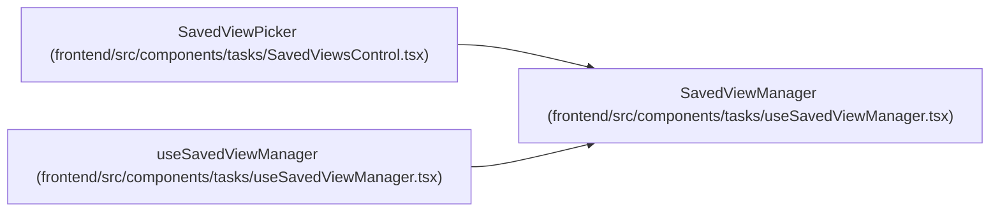

# SavedViewManager

**Location:** `frontend/src/components/tasks/useSavedViewManager.tsx:333`
**Kind:** Type alias
**Bases:** —
**Module:** [useSavedViewManager](../modules/useSavedViewManager.md)
**Target:**

```typescript
ReturnType<typeof useSavedViewManager>
```

## Description

_Auto-generated from `SavedViewManager` in `frontend/src/components/tasks/useSavedViewManager.tsx`._

## Attributes

*See the alias definition for its member types.*

## Methods

*See the alias definition for callable and member types.*

## Relationships

<!-- Auto-generated relationship summary. Do not edit by hand. -->


### Summary

| Module | Methods | Attributes |
|---|---:|---|
| [useSavedViewManager](../modules/useSavedViewManager.md) | 0 | — |

### References

| Reference | Kind | Source | Call sites |
|---|---|---|---:|
| `SavedViewPicker` | type_reference | [SavedViewsControl](../modules/SavedViewsControl.md) | — |
| `useSavedViewManager` | type_reference | [useSavedViewManager](../modules/useSavedViewManager.md) | — |
