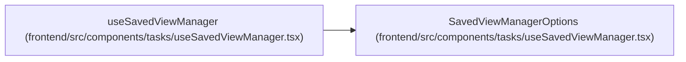

# SavedViewManagerOptions

**Location:** `frontend/src/components/tasks/useSavedViewManager.tsx:24`
**Kind:** Interface
**Bases:** —
**Module:** [useSavedViewManager](../modules/useSavedViewManager.md)

## Description

_Auto-generated from `SavedViewManagerOptions` in `frontend/src/components/tasks/useSavedViewManager.tsx`._

## Attributes

| Name | Type | Required | Default | Description |
|------|------|----------|---------|-------------|
| `filters` | `TaskFilters` | Yes | — | — |
| `sortKey` | `SortKey` | Yes | — | — |
| `systemFilters` | `Partial<TaskFilters>` | No | — | — |
| `selectedViewId` | `number \| null` | Yes | — | — |
| `onSelectedViewIdChange` | `(viewId: number \| null) => void` | Yes | — | — |
| `onApplyView` | `(view: SavedView) => void` | Yes | — | — |

## Methods

*No declared methods.*

## Relationships

<!-- Auto-generated relationship summary. Do not edit by hand. -->

### Summary

| Module | Methods | Attributes |
|---|---:|---|
| [useSavedViewManager](../modules/useSavedViewManager.md) | 0 | `filters`, `onApplyView`, `onSelectedViewIdChange`, `selectedViewId`, `sortKey`, `systemFilters` |

### References

| Reference | Kind | Source | Call sites |
|---|---|---|---:|
| `useSavedViewManager` | type_reference | [useSavedViewManager](../modules/useSavedViewManager.md) | — |
