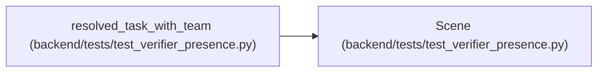

# Scene

**Location:** `backend/tests/test_verifier_presence.py:32`
**Kind:** Class
**Bases:** —
**Module:** [test_verifier_presence](../modules/test_verifier_presence.md)

## Description

A resolved task, its team, and the ids that stay usable after a rollback.

## Attributes

*No annotated attributes found.*

## Methods

| Method | Signature | Decorators | Description |
|--------|-----------|------------|-------------|
| `__init__` | `(**values)` | — | — |

## Relationships

<!-- Auto-generated relationship summary. Do not edit by hand. -->

### Summary

| Module | Methods | Attributes |
|---|---:|---|
| [test_verifier_presence](../modules/test_verifier_presence.md) | 1 | — |

### References

| Reference | Kind | Source | Call sites |
|---|---|---|---:|
| `resolved_task_with_team` | call | [test_verifier_presence](../modules/test_verifier_presence.md) | 1 |
