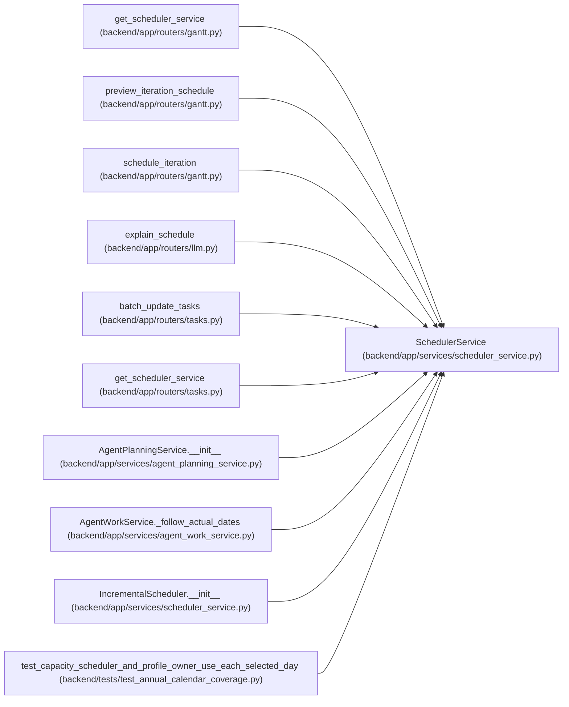

# SchedulerService

**Location:** `backend/app/services/scheduler_service.py:389`
**Kind:** Class
**Bases:** —
**Module:** [scheduler_service](../modules/scheduler_service.md)

## Description

Service for automatic task scheduling.

## Attributes

*No annotated attributes found.*

## Methods

| Method | Signature | Decorators | Description |
|--------|-----------|------------|-------------|
| `__init__` | `(db: AsyncSession)` | — | — |
| `schedule_iteration` | *(async)* `(iteration_id: int, *, commit: bool = True, expected_revision: int \| None = None, expected_planning_revision: int \| None = None, commit_baseline: bool = False, protect_issued: bool = False, rebaseline_reason: str \| None = None, follow_date: date \| None = None, anchor_task_id: int \| None = None) -> ScheduleResult` | `@atomic_command` | Schedule an iteration, optionally leaving commit ownership to the caller. |
| `follow_actual_dates` | *(async)* `(task: Task, today: date, *, started: bool = False) -> list[int]` | — | Move planned work to what really happened after ``task`` started or finished. |
| `_date_rule_violation` | `(task: Task, saved: tuple[date \| None, date \| None], iteration: Iteration) -> str \| None` | `@staticmethod` | The first rule the saved dates break for this iteration, or None when they are valid. |
| `_date_rule_message` | `(rule: str, task: Task, iteration_dates: tuple[date, date] \| None = None) -> str` | — | — |
| `_unscheduled_tasks` | `(all_tasks: Sequence[Task], member_schedules: dict[int, 'MemberSchedule'], known_reasons: dict[int, str], messages: dict[int, str] \| None = None, before_dates: dict[int, tuple[date \| None, date \| None]] \| None = None, *, kept_dates: dict[int, str \| None] \| None = None, incomplete_ids: set[int] \| None = None, postponed_waits: dict[int, list[Task]] \| None = None, iteration_dates: tuple[date, date] \| None = None, planning_start: date \| None = None, satisfied_ids: set[int] \| None = None) -> tuple[list[UnscheduledTask], list[KeptDatesTask]]` | — | Planned leaf tasks the run could not place, each with the first cause that applies. |
| `_kept_dates_notes` | `(task: Task, by_id: dict[int, Task], kept_dates: dict[int, str \| None], planning_start: date \| None, satisfied_ids: set[int]) -> list[str]` | `@staticmethod` | Limits of dates kept as saved: they were not checked against the plan the run placed. |
| `_build_member_schedules` | *(async)* `(iteration: Iteration, team_members: Sequence[TeamMember]) -> dict[int, MemberSchedule]` | — | Build schedule tracking for each team member. |
| `_topological_sort` | `(tasks: list[Task]) -> list[Task]` | — | Sort tasks respecting dependencies. |
| `_topological_sort_children` | `(children: list[Task], child_ids: set[int]) -> list[Task]` | — | Sort child tasks respecting internal dependencies, then by (is_optional, priority). |
| `_get_dependency_depth` | `(task: Task, all_tasks: Sequence[Task]) -> int` | — | Get the depth of a task in dependency chain. |
| `_calculate_adjusted_effort` | `(task: Task) -> int` | — | Calculate adjusted effort days after applying assignee coefficients. |
| `_build_task_context` | `(task: Task, task_can_fit_before_vacation: dict[int, bool]) -> dict` | — | Build task context dictionary for YAML pass filters and sorting. |
| `_effective_flags` | `(task)` | — | — |
| `_postponed_waits` | `(all_tasks: Sequence[Task], task_map: dict[int, Task]) -> dict[int, list[Task]]` | — | Planned leaves that wait on postponed work, each with the postponed tasks it waits on. |
| `_postponed_wait_message` | `(postponed: Sequence[Task]) -> str` | `@staticmethod` | — |
| `_holds_no_schedule` | `(task) -> bool` | — | Deferred work is backlog and postponed work is stopped: neither is placed nor occupies capacity. |
| `_planning_start` | `(iteration: Iteration) -> date` | `@staticmethod` | Keep new forecasts on or after the workspace's current working date. |
| `_schedule_leaf_task` | *(async)* `(task: Task, iteration: Iteration, member_schedules: dict[int, MemberSchedule], decisions: list[SchedulingDecision], task_map: dict[int, Task], earliest_start: Optional[date] = None)` | — | Schedule a leaf task (no children). |
| `_place_in_free_days` | `(task: Task, iteration: Iteration, member_schedules: dict[int, MemberSchedule], decisions: list[SchedulingDecision], task_map: dict[int, Task], earliest_start: date, cursor: date) -> bool` | — | Place a ready task in free days its row left before already placed work, if it fits there. |
| `_idle_days` | `(member_schedules: dict[int, MemberSchedule], task_map: dict[int, Task], span_start: date, planned_ids: set[int], satisfied_ids: set[int], kept_ids: set[int]) -> list[AssigneeIdleDays]` | — | Each row's working days left idle before its last work in this run, with the task that follows them. |
| `_idle_gap` | `(run: list[date], task_id: int, task_map: dict[int, Task], schedule: MemberSchedule, planned_ids: set[int], satisfied_ids: set[int]) -> IdleGap` | — | — |
| `_schedule_composite_task` | *(async)* `(task: Task, iteration: Iteration, member_schedules: dict[int, MemberSchedule], decisions: list[SchedulingDecision], task_map: dict[int, Task], parent_earliest_start: Optional[date] = None)` | — | Schedule a composite task (with children). |
| `_get_earliest_start` | `(task: Task, iteration_start: date, task_map: dict[int, Task]) -> date` | — | Get earliest possible start date based on dependencies. |
| `_update_composite_task_dates` | `(task: Task, iteration: Iteration, decisions: list[SchedulingDecision])` | — | Update a composite task's dates based on its children. |
| `_check_workload_balance` | `(member_schedules: dict[int, MemberSchedule]) -> list[WorkloadIssue]` | — | Check for workload imbalances. |

## Relationships

<!-- Auto-generated relationship summary. Do not edit by hand. -->

### Summary

| Module | Methods | Attributes |
|---|---:|---|
| [scheduler_service](../modules/scheduler_service.md) | 26 | — |

### References

| Reference | Kind | Source | Call sites |
|---|---|---|---:|
| `get_scheduler_service` | call | [routers_gantt](../modules/routers_gantt.md) | 1 |
| `get_scheduler_service` | type_reference | [routers_gantt](../modules/routers_gantt.md) | — |
| `preview_iteration_schedule` | type_reference | [routers_gantt](../modules/routers_gantt.md) | — |
| `schedule_iteration` | type_reference | [routers_gantt](../modules/routers_gantt.md) | — |
| `explain_schedule` | call | [routers_llm](../modules/routers_llm.md) | 1 |
| `batch_update_tasks` | type_reference | [tasks](../modules/tasks.md) | — |
| `get_scheduler_service` | call | [tasks](../modules/tasks.md) | 1 |
| `get_scheduler_service` | type_reference | [tasks](../modules/tasks.md) | — |
| `AgentPlanningService.__init__` | call | [agent_planning_service](../modules/agent_planning_service.md) | 1 |
| `AgentWorkService._follow_actual_dates` | call | [agent_work_service](../modules/agent_work_service.md) | 1 |
| `IncrementalScheduler.__init__` | type_reference | [scheduler_service](../modules/scheduler_service.md) | — |
| `test_capacity_scheduler_and_profile_owner_use_each_selected_day` | call | [test_annual_calendar_coverage](../modules/test_annual_calendar_coverage.md) | 1 |

> References: showing 12 of 66 logical references; 54 omitted by the 12-row generated summary limit.
