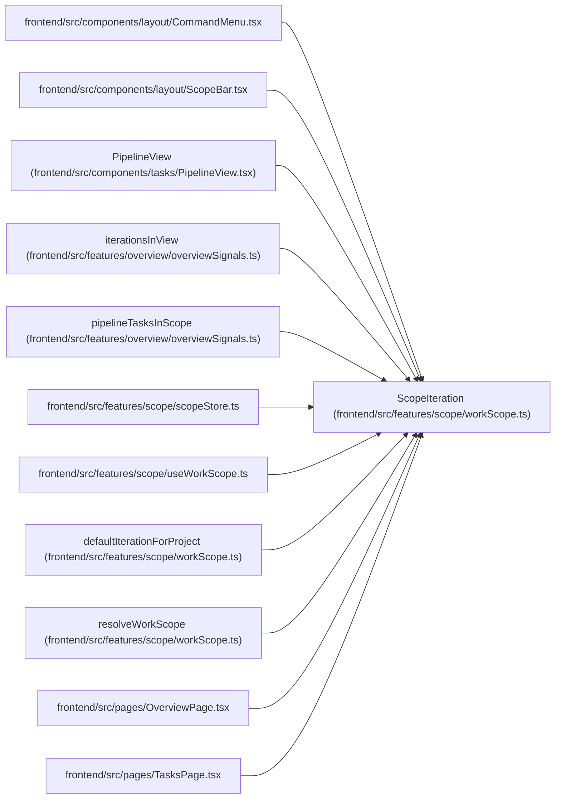

# ScopeIteration

**Location:** `frontend/src/features/scope/workScope.ts:8`
**Kind:** Type alias
**Bases:** —
**Module:** [workScope](../modules/workScope.md)
**Target:**

```typescript
number | 'backlog'
```

## Description

One iteration, or work that has no iteration.

## Attributes

*See the alias definition for its member types.*

## Methods

*See the alias definition for callable and member types.*

## Relationships

<!-- Auto-generated relationship summary. Do not edit by hand. -->


### Summary

| Module | Methods | Attributes |
|---|---:|---|
| [workScope](../modules/workScope.md) | 0 | — |

### References

| Reference | Kind | Source | Call sites |
|---|---|---|---:|
| `CommandMenu` | import | [CommandMenu](../modules/CommandMenu.md) | — |
| `ScopeBar` | import | [ScopeBar](../modules/ScopeBar.md) | — |
| `PipelineView` | type_reference | [PipelineView](../modules/PipelineView.md) | — |
| `iterationsInView` | type_reference | [overviewSignals](../modules/overviewSignals.md) | — |
| `pipelineTasksInScope` | type_reference | [overviewSignals](../modules/overviewSignals.md) | — |
| `scopeStore` | import | [scopeStore](../modules/scopeStore.md) | — |
| `useWorkScope` | import | [useWorkScope](../modules/useWorkScope.md) | — |
| `defaultIterationForProject` | type_reference | [workScope](../modules/workScope.md) | — |
| `resolveWorkScope` | type_reference | [workScope](../modules/workScope.md) | — |
| `OverviewPage` | import | [OverviewPage](../modules/OverviewPage.md) | — |
| `TasksPage` | import | [TasksPage](../modules/TasksPage.md) | — |
