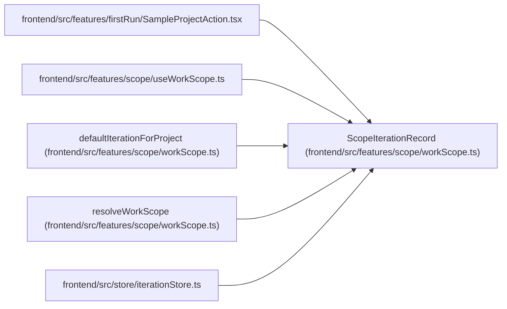

# ScopeIterationRecord

**Location:** `frontend/src/features/scope/workScope.ts:21`
**Kind:** Interface
**Bases:** —
**Module:** [workScope](../modules/workScope.md)

## Description

_Auto-generated from `ScopeIterationRecord` in `frontend/src/features/scope/workScope.ts`._

## Attributes

| Name | Type | Required | Default | Description |
|------|------|----------|---------|-------------|
| `id` | `number` | Yes | — | — |
| `project_id` | `number \| null` | No | — | — |
| `start_date` | `string` | Yes | — | — |
| `end_date` | `string` | Yes | — | — |

## Methods

*No declared methods.*

## Relationships

<!-- Auto-generated relationship summary. Do not edit by hand. -->

### Summary

| Module | Methods | Attributes |
|---|---:|---|
| [workScope](../modules/workScope.md) | 0 | `end_date`, `id`, `project_id`, `start_date` |

### References

| Reference | Kind | Source | Call sites |
|---|---|---|---:|
| `SampleProjectAction` | import | [SampleProjectAction](../modules/SampleProjectAction.md) | — |
| `useWorkScope` | import | [useWorkScope](../modules/useWorkScope.md) | — |
| `defaultIterationForProject` | type_reference | [workScope](../modules/workScope.md) | — |
| `resolveWorkScope` | type_reference | [workScope](../modules/workScope.md) | — |
| `iterationStore` | import | [iterationStore](../modules/iterationStore.md) | — |
