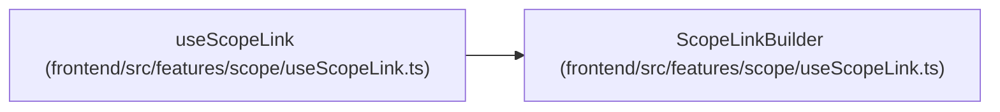

# ScopeLinkBuilder

**Location:** `frontend/src/features/scope/useScopeLink.ts:8`
**Kind:** Type alias
**Bases:** —
**Module:** [useScopeLink](../modules/useScopeLink.md)
**Target:**

```typescript
(to: string, override?: PartialWorkScope) => string
```

## Description

Builds a link to `to`; values in `override` replace those of the current scope.

## Attributes

*See the alias definition for its member types.*

## Methods

*See the alias definition for callable and member types.*

## Relationships

<!-- Auto-generated relationship summary. Do not edit by hand. -->


### Summary

| Module | Methods | Attributes |
|---|---:|---|
| [useScopeLink](../modules/useScopeLink.md) | 0 | — |

### References

| Reference | Kind | Source | Call sites |
|---|---|---|---:|
| `useScopeLink` | type_reference | [useScopeLink](../modules/useScopeLink.md) | — |
