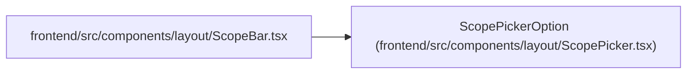

# ScopePickerOption

**Location:** `frontend/src/components/layout/ScopePicker.tsx:7`
**Kind:** Interface
**Bases:** —
**Module:** [ScopePicker](../modules/ScopePicker.md)

## Description

_Auto-generated from `ScopePickerOption` in `frontend/src/components/layout/ScopePicker.tsx`._

## Attributes

| Name | Type | Required | Default | Description |
|------|------|----------|---------|-------------|
| `key` | `string` | Yes | — | — |
| `label` | `string` | Yes | — | — |
| `detail` | `string` | No | — | — |
| `marker` | `string` | No | — | — |
| `keywords` | `string` | No | — | — |
| `group` | `string` | No | — | — |
| `action` | `boolean` | No | — | — |
| `selected` | `boolean` | No | — | — |

## Methods

*No declared methods.*

## Relationships

<!-- Auto-generated relationship summary. Do not edit by hand. -->

### Summary

| Module | Methods | Attributes |
|---|---:|---|
| [ScopePicker](../modules/ScopePicker.md) | 0 | `action`, `detail`, `group`, `key`, `keywords`, `label`, `marker`, `selected` |

### References

| Reference | Kind | Source | Call sites |
|---|---|---|---:|
| `ScopeBar` | import | [ScopeBar](../modules/ScopeBar.md) | — |
