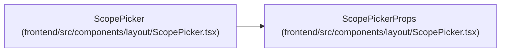

# ScopePickerProps

**Location:** `frontend/src/components/layout/ScopePicker.tsx:25`
**Kind:** Interface
**Bases:** —
**Module:** [ScopePicker](../modules/ScopePicker.md)

## Description

_Auto-generated from `ScopePickerProps` in `frontend/src/components/layout/ScopePicker.tsx`._

## Attributes

| Name | Type | Required | Default | Description |
|------|------|----------|---------|-------------|
| `label` | `string` | Yes | — | — |
| `valueLabel` | `string` | Yes | — | — |
| `options` | `readonly ScopePickerOption[]` | Yes | — | — |
| `onChoose` | `(option: ScopePickerOption) => void` | Yes | — | — |
| `searchHint` | `string` | Yes | — | — |
| `noMatches` | `string` | Yes | — | — |
| `disabled` | `boolean` | No | — | — |
| `className` | `string` | No | — | — |
| `renderOption` | `(option: ScopePickerOption) => ReactNode` | No | — | — |

## Methods

*No declared methods.*

## Relationships

<!-- Auto-generated relationship summary. Do not edit by hand. -->

### Summary

| Module | Methods | Attributes |
|---|---:|---|
| [ScopePicker](../modules/ScopePicker.md) | 0 | `className`, `disabled`, `label`, `noMatches`, `onChoose`, `options`, `renderOption`, `searchHint`, `valueLabel` |

### References

| Reference | Kind | Source | Call sites |
|---|---|---|---:|
| `ScopePicker` | type_reference | [ScopePicker](../modules/ScopePicker.md) | — |
