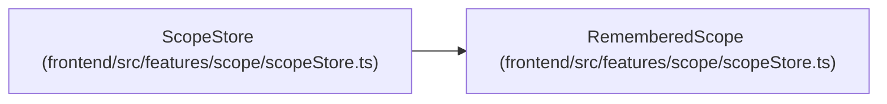

# ScopeStore

**Location:** `frontend/src/features/scope/scopeStore.ts:15`
**Kind:** Interface
**Bases:** `RememberedScope`
**Module:** [scopeStore](../modules/scopeStore.md)

## Description

_Auto-generated from `ScopeStore` in `frontend/src/features/scope/scopeStore.ts`._

## Attributes

| Name | Type | Required | Default | Description |
|------|------|----------|---------|-------------|
| `remember` | `(scope: PartialWorkScope) => void` | Yes | — | — |

## Methods

*No declared methods.*

## Relationships

<!-- Auto-generated relationship summary. Do not edit by hand. -->

### Summary

| Module | Methods | Attributes |
|---|---:|---|
| [scopeStore](../modules/scopeStore.md) | 0 | `remember` |

### Structure

| Kind | Entity | Module |
|---|---|---|
| Base | `RememberedScope` | [scopeStore](../modules/scopeStore.md) |
