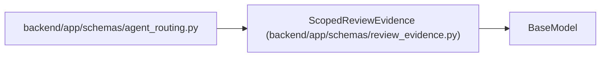

# ScopedReviewEvidence

**Location:** `backend/app/schemas/review_evidence.py:69`
**Kind:** Pydantic model
**Bases:** `BaseModel`
**Module:** [schemas_review_evidence](../modules/schemas_review_evidence.md)

## Description

Compact owner and validity information returned by a scoped verification preview.

The preview reports the receipt, packet and candidate digests along with the verifier's exact binding and expiry. When the PM requests an existing-assignment readback, the same summary includes the current assignment ID and state.

## Model Configuration

| Setting | Value | Source |
|---------|-------|--------|
| `extra` | `'forbid'` | model_config |

## Attributes

| Name | Type | Wire name | Required | Nullable | Default | Constraints | Examples | Description |
|------|------|-----------|----------|----------|---------|-------------|-------------|----------|
| `id` | `Positive` | `id` | Yes | No | — | — | — | — |
| `digest` | `Sha256` | `digest` | Yes | No | — | — | — | — |
| `candidate_digest` | `Sha256` | `candidate_digest` | Yes | No | — | — | — | — |
| `packet_sha256` | `Sha256` | `packet_sha256` | Yes | No | — | — | — | — |
| `method` | `Literal['source_only', 'source_and_tests']` | `method` | Yes | No | — | — | — | — |
| `reviewer_actor_id` | `Positive` | `reviewer_actor_id` | Yes | No | — | — | — | — |
| `binding_id` | `Positive` | `binding_id` | Yes | No | — | — | — | — |
| `binding_revision` | `Positive` | `binding_revision` | Yes | No | — | — | — | — |
| `expires_at` | `AwareDatetime` | `expires_at` | Yes | No | — | — | — | — |
| `assignment_id` | `Positive \| None` | `assignment_id` | No | Yes | `None` | — | — | — |
| `assignment_state` | `Literal['queued', 'accepted'] \| None` | `assignment_state` | No | Yes | `None` | — | — | — |

## Methods

*No declared methods.*

## Relationships

<!-- Auto-generated relationship summary. Do not edit by hand. -->

### Summary

| Module | Methods | Attributes |
|---|---:|---|
| [schemas_review_evidence](../modules/schemas_review_evidence.md) | 0 | `assignment_id`, `assignment_state`, `binding_id`, `binding_revision`, `candidate_digest`, `digest`, `expires_at`, `id`, `method`, `packet_sha256`, `reviewer_actor_id` |

### Structure

| Kind | Entity | Module |
|---|---|---|
| Base | `BaseModel` | — |

### References

| Reference | Kind | Source | Call sites |
|---|---|---|---:|
| `agent_routing` | import | [agent_routing](../modules/agent_routing.md) | — |
