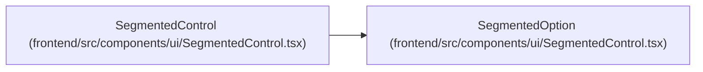

# SegmentedOption

**Location:** `frontend/src/components/ui/SegmentedControl.tsx:4`
**Kind:** Interface
**Bases:** —
**Module:** [SegmentedControl](../modules/SegmentedControl.md)
**Type parameters:** `T extends string`

## Description

_Auto-generated from `SegmentedOption` in `frontend/src/components/ui/SegmentedControl.tsx`._

## Attributes

| Name | Type | Required | Default | Description |
|------|------|----------|---------|-------------|
| `value` | `T` | Yes | — | — |
| `label` | `ReactNode` | Yes | — | — |
| `icon` | `ReactNode` | No | — | — |

## Methods

*No declared methods.*

## Relationships

<!-- Auto-generated relationship summary. Do not edit by hand. -->

### Summary

| Module | Methods | Attributes |
|---|---:|---|
| [SegmentedControl](../modules/SegmentedControl.md) | 0 | `icon`, `label`, `value` |

### References

| Reference | Kind | Source | Call sites |
|---|---|---|---:|
| `SegmentedControl` | type_reference | [SegmentedControl](../modules/SegmentedControl.md) | — |
