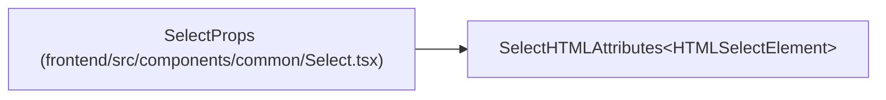

# SelectProps

**Location:** `frontend/src/components/common/Select.tsx:6`
**Kind:** Interface
**Bases:** `SelectHTMLAttributes<HTMLSelectElement>`
**Module:** [Select](../modules/Select.md)

## Description

_Auto-generated from `SelectProps` in `frontend/src/components/common/Select.tsx`._

## Attributes

| Name | Type | Required | Default | Description |
|------|------|----------|---------|-------------|
| `label` | `ReactNode` | No | — | — |
| `help` | `ReactNode` | No | — | — |
| `error` | `string` | No | — | — |

## Methods

*No declared methods.*

## Relationships

<!-- Auto-generated relationship summary. Do not edit by hand. -->

### Summary

| Module | Methods | Attributes |
|---|---:|---|
| [Select](../modules/Select.md) | 0 | `error`, `help`, `label` |

### Structure

| Kind | Entity | Module |
|---|---|---|
| Base | `SelectHTMLAttributes<HTMLSelectElement>` | — |
