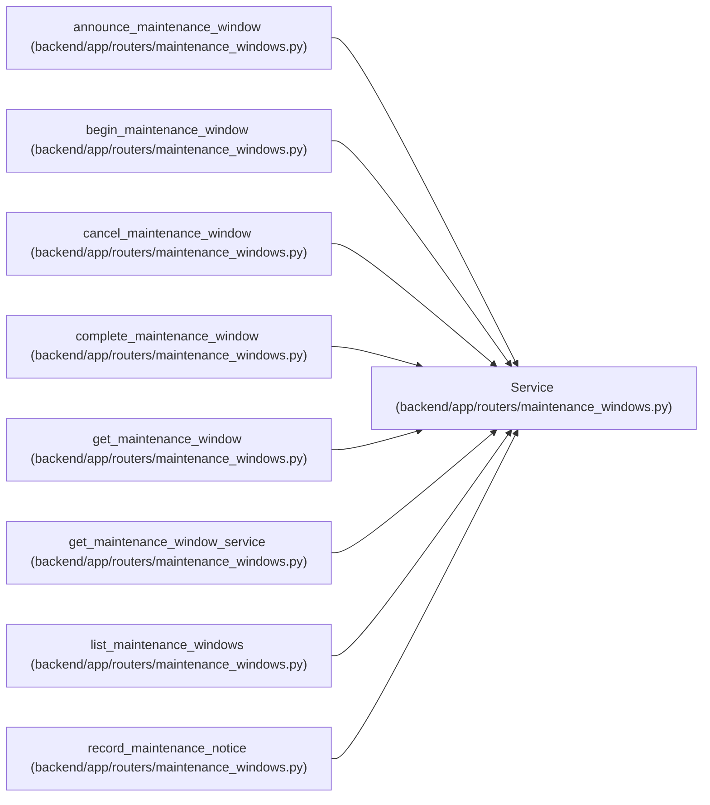

# Service

**Location:** `backend/app/routers/maintenance_windows.py:34`
**Kind:** Type alias
**Bases:** —
**Module:** [maintenance_windows](../modules/maintenance_windows.md)
**Target:** `Annotated[MaintenanceWindowService, Depends(get_maintenance_window_service)]`

## Description

_Auto-generated from `Service` in `backend/app/routers/maintenance_windows.py`._

## Attributes

*See the alias definition for its member types.*

## Methods

*See the alias definition for callable and member types.*

## Relationships

<!-- Auto-generated relationship summary. Do not edit by hand. -->

### Summary

| Module | Methods | Attributes |
|---|---:|---|
| [maintenance_windows](../modules/maintenance_windows.md) | 0 | — |

### References

| Reference | Kind | Source | Call sites |
|---|---|---|---:|
| `announce_maintenance_window` | type_reference | [maintenance_windows](../modules/maintenance_windows.md) | — |
| `begin_maintenance_window` | type_reference | [maintenance_windows](../modules/maintenance_windows.md) | — |
| `cancel_maintenance_window` | type_reference | [maintenance_windows](../modules/maintenance_windows.md) | — |
| `complete_maintenance_window` | type_reference | [maintenance_windows](../modules/maintenance_windows.md) | — |
| `get_maintenance_window` | type_reference | [maintenance_windows](../modules/maintenance_windows.md) | — |
| `get_maintenance_window_service` | type_reference | [maintenance_windows](../modules/maintenance_windows.md) | — |
| `list_maintenance_windows` | type_reference | [maintenance_windows](../modules/maintenance_windows.md) | — |
| `record_maintenance_notice` | type_reference | [maintenance_windows](../modules/maintenance_windows.md) | — |
