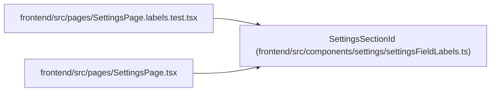

# SettingsSectionId

**Location:** `frontend/src/components/settings/settingsFieldLabels.ts:1`
**Kind:** Type alias
**Bases:** —
**Module:** [settingsFieldLabels](../modules/settingsFieldLabels.md)
**Target:**

```typescript
| 'theme' | 'shortcuts'
    | 'language' | 'work_calendar' | 'scheduling' | 'templates_labels' | 'notifications'
    | 'github' | 'webhooks' | 'web_intake' | 'ai_provider'
    | 'access' | 'runtime' | 'about'
```

## Description

_Auto-generated from `SettingsSectionId` in `frontend/src/components/settings/settingsFieldLabels.ts`._

## Attributes

*See the alias definition for its member types.*

## Methods

*See the alias definition for callable and member types.*

## Relationships

<!-- Auto-generated relationship summary. Do not edit by hand. -->


### Summary

| Module | Methods | Attributes |
|---|---:|---|
| [settingsFieldLabels](../modules/settingsFieldLabels.md) | 0 | — |

### References

| Reference | Kind | Source | Call sites |
|---|---|---|---:|
| `SettingsPage.labels.test` | import | [SettingsPage.labels.test](../modules/SettingsPage.labels.test.md) | — |
| `SettingsPage` | import | [SettingsPage](../modules/SettingsPage.md) | — |
