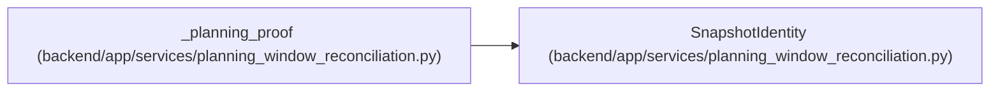

# SnapshotIdentity

**Location:** `backend/app/services/planning_window_reconciliation.py:37`
**Kind:** Class
**Bases:** —
**Module:** [planning_window_reconciliation](../modules/planning_window_reconciliation.md)

**Decorators:** `@dataclass(frozen=True)`

## Description

_Auto-generated from `SnapshotIdentity` in `backend/app/services/planning_window_reconciliation.py`._

Reconciliation uses this identity to link the task to the operator’s original pre-change snapshot. It records the snapshot ID, checksum, input revision, capture time and earlier iteration end date without duplicating the iteration payload.

## Attributes

| Name | Type | Default | Description |
|------|------|---------|-------------|
| `id` | `int` | *required* | — |
| `checksum` | `str` | *required* | — |
| `input_revision` | `int` | *required* | — |
| `created_at` | `datetime` | *required* | — |
| `previous_end` | `str` | *required* | — |

## Methods

*No declared methods.*

## Relationships

<!-- Auto-generated relationship summary. Do not edit by hand. -->

### Summary

| Module | Methods | Attributes |
|---|---:|---|
| [planning_window_reconciliation](../modules/planning_window_reconciliation.md) | 0 | `checksum`, `created_at`, `id`, `input_revision`, `previous_end` |

### References

| Reference | Kind | Source | Call sites |
|---|---|---|---:|
| `_planning_proof` | call | [planning_window_reconciliation](../modules/planning_window_reconciliation.md) | 1 |
