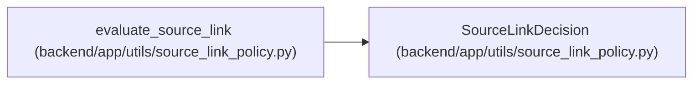

# SourceLinkDecision

**Location:** `backend/app/utils/source_link_policy.py:55`
**Kind:** Class
**Bases:** —
**Module:** [source_link_policy](../modules/source_link_policy.md)

**Decorators:** `@dataclass(frozen=True)`

## Description

What the policy does with one source link.

## Attributes

| Name | Type | Default | Description |
|------|------|---------|-------------|
| `action` | `SourceLinkAction` | *required* | — |
| `original` | `Optional[str]` | *required* | — |
| `value` | `Optional[str]` | *required* | — |
| `reason` | `Optional[str]` | `None` | — |

## Methods

| Method | Signature | Decorators | Description |
|--------|-----------|------------|-------------|
| `message` | `() -> Optional[str]` | — | — |

## Relationships

<!-- Auto-generated relationship summary. Do not edit by hand. -->

### Summary

| Module | Methods | Attributes |
|---|---:|---|
| [source_link_policy](../modules/source_link_policy.md) | 1 | `action`, `original`, `reason`, `value` |

### References

| Reference | Kind | Source | Call sites |
|---|---|---|---:|
| `evaluate_source_link` | call | [source_link_policy](../modules/source_link_policy.md) | 7 |
| `evaluate_source_link` | type_reference | [source_link_policy](../modules/source_link_policy.md) | — |
