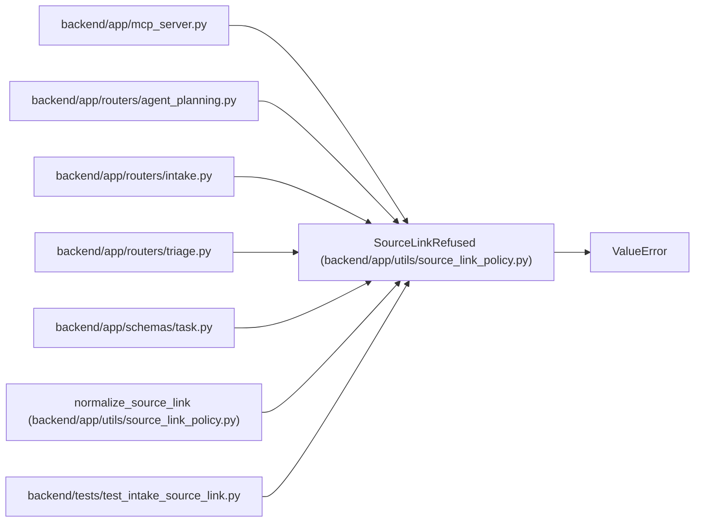

# SourceLinkRefused

**Location:** `backend/app/utils/source_link_policy.py:35`
**Kind:** Class
**Bases:** `ValueError`
**Module:** [source_link_policy](../modules/source_link_policy.md)

## Description

Raised when a source link breaks the policy; carries a stable, named error.

## Attributes

*No annotated attributes found.*

## Methods

| Method | Signature | Decorators | Description |
|--------|-----------|------------|-------------|
| `__init__` | `(reason: str) -> None` | — | — |
| `detail` | `() -> dict[str, str]` | — | — |

## Relationships

<!-- Auto-generated relationship summary. Do not edit by hand. -->

### Summary

| Module | Methods | Attributes |
|---|---:|---|
| [source_link_policy](../modules/source_link_policy.md) | 2 | — |

### Structure

| Kind | Entity | Module |
|---|---|---|
| Base | `ValueError` | — |

### References

| Reference | Kind | Source | Call sites |
|---|---|---|---:|
| `mcp_server` | import | [mcp_server](../modules/mcp_server.md) | — |
| `agent_planning` | import | [routers_agent_planning](../modules/routers_agent_planning.md) | — |
| `intake` | import | [routers_intake](../modules/routers_intake.md) | — |
| `triage` | import | [routers_triage](../modules/routers_triage.md) | — |
| `task` | import | [schemas_task](../modules/schemas_task.md) | — |
| `normalize_source_link` | call | [source_link_policy](../modules/source_link_policy.md) | 1 |
| `test_intake_source_link` | import | [test_intake_source_link](../modules/test_intake_source_link.md) | — |
