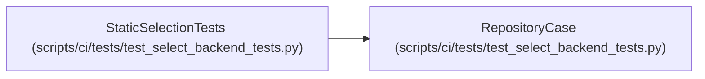

# StaticSelectionTests

**Location:** `scripts/ci/tests/test_select_backend_tests.py:127`
**Kind:** Class
**Bases:** `RepositoryCase`
**Module:** [test_select_backend_tests](../modules/test_select_backend_tests.md)

## Description

_Auto-generated from `StaticSelectionTests` in `scripts/ci/tests/test_select_backend_tests.py`._

## Attributes

*No annotated attributes found.*

## Methods

| Method | Signature | Decorators | Description |
|--------|-----------|------------|-------------|
| `test_reverse_imports_are_followed_transitively` | `() -> None` | — | — |
| `test_from_package_import_module_resolves_to_the_module` | `() -> None` | — | — |
| `test_changed_test_is_selected_with_smoke` | `() -> None` | — | — |
| `test_non_python_change_selects_tests_that_name_it` | `() -> None` | — | — |
| `test_unrelated_change_selects_only_smoke` | `() -> None` | — | — |
| `test_cli_prints_json` | `() -> None` | — | — |

## Relationships

<!-- Auto-generated relationship summary. Do not edit by hand. -->

### Summary

| Module | Methods | Attributes |
|---|---:|---|
| [test_select_backend_tests](../modules/test_select_backend_tests.md) | 6 | — |

### Structure

| Kind | Entity | Module |
|---|---|---|
| Base | `RepositoryCase` | [test_select_backend_tests](../modules/test_select_backend_tests.md) |
