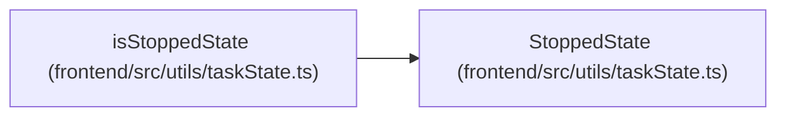

# StoppedState

**Location:** `frontend/src/utils/taskState.ts:9`
**Kind:** Type alias
**Bases:** —
**Module:** [taskState](../modules/taskState.md)
**Target:**

```typescript
typeof STOPPED_STATES[number]
```

## Description

_Auto-generated from `StoppedState` in `frontend/src/utils/taskState.ts`._

## Attributes

*See the alias definition for its member types.*

## Methods

*See the alias definition for callable and member types.*

## Relationships

<!-- Auto-generated relationship summary. Do not edit by hand. -->


### Summary

| Module | Methods | Attributes |
|---|---:|---|
| [taskState](../modules/taskState.md) | 0 | — |

### References

| Reference | Kind | Source | Call sites |
|---|---|---|---:|
| `isStoppedState` | type_reference | [taskState](../modules/taskState.md) | — |
