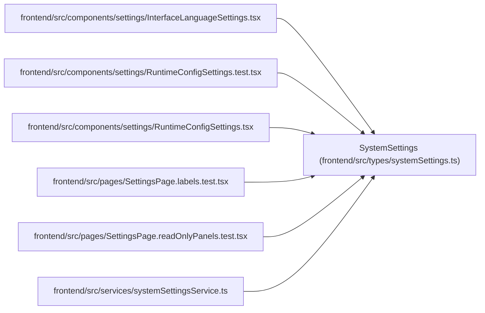

# SystemSettings

**Location:** `frontend/src/types/systemSettings.ts:77`
**Kind:** Interface
**Bases:** —
**Module:** [systemSettings](../modules/systemSettings.md)

## Description

_Auto-generated from `SystemSettings` in `frontend/src/types/systemSettings.ts`._

## Attributes

| Name | Type | Required | Default | Description |
|------|------|----------|---------|-------------|
| `app` | `AppRuntimeSettings` | Yes | — | — |
| `llm` | `LLMRuntimeSettings` | Yes | — | — |
| `github` | `GitHubRuntimeSettings` | Yes | — | — |
| `web_intake` | `WebIntakeRuntimeSettings` | Yes | — | — |
| `restart_required` | `RestartRequiredSetting[]` | Yes | — | — |
| `redacted_fields` | `string[]` | No | — | — |

## Methods

*No declared methods.*

## Relationships

<!-- Auto-generated relationship summary. Do not edit by hand. -->

### Summary

| Module | Methods | Attributes |
|---|---:|---|
| [systemSettings](../modules/systemSettings.md) | 0 | `app`, `github`, `llm`, `redacted_fields`, `restart_required`, `web_intake` |

### References

| Reference | Kind | Source | Call sites |
|---|---|---|---:|
| `InterfaceLanguageSettings` | import | [InterfaceLanguageSettings](../modules/InterfaceLanguageSettings.md) | — |
| `RuntimeConfigSettings.test` | import | [RuntimeConfigSettings.test](../modules/RuntimeConfigSettings.test.md) | — |
| `RuntimeConfigSettings` | import | [RuntimeConfigSettings](../modules/RuntimeConfigSettings.md) | — |
| `SettingsPage.labels.test` | import | [SettingsPage.labels.test](../modules/SettingsPage.labels.test.md) | — |
| `SettingsPage.readOnlyPanels.test` | import | [SettingsPage.readOnlyPanels.test](../modules/SettingsPage.readOnlyPanels.test.md) | — |
| `systemSettingsService` | import | [systemSettingsService](../modules/systemSettingsService.md) | — |
